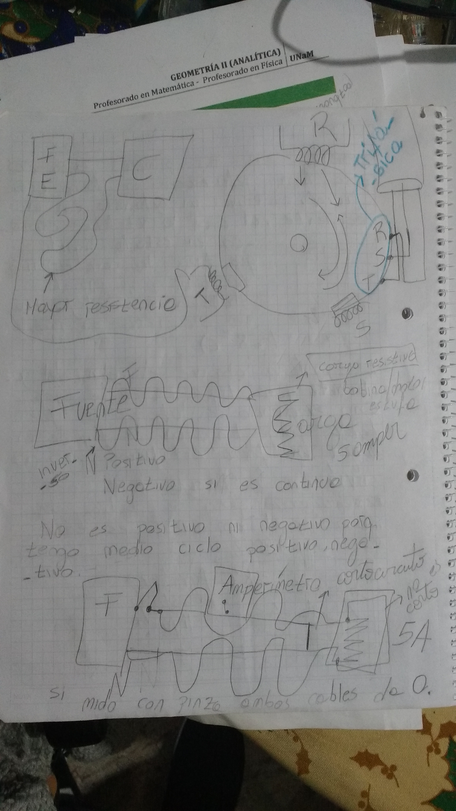
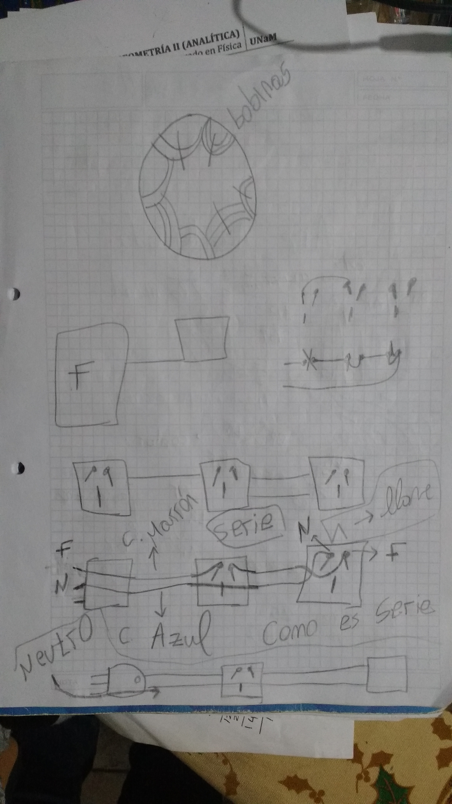

% Clase Nº 2: Ventiladores, armado de lámpara serie y jarra eléctrica
% Andrés Imlauer
% 16 Julio 2024

## Audio de la clase:

[https://www.youtube.com/watch?v=3nJnAqAZQpY](https://www.youtube.com/watch?v=3nJnAqAZQpY)

[https://vocaroo.com/1jjk6YDCw6js](https://vocaroo.com/1jjk6YDCw6js)

### O miralo desde una instancia de invidious

[https://redirect.invidious.io/watch?v=3nJnAqAZQpY](https://redirect.invidious.io/watch?v=3nJnAqAZQpY)

Aquí te destaco los puntos más importantes de todo lo que compartiste, en forma clara y resumida:

***

### 🔧 Motor y ventilador

* El **ventilador se calienta** porque el motor está frenado y trabaja exigido → mayor consumo de potencia → aumenta el amperaje.
* Puede deberse a que el **rotor no está centrado en el estator**, lo que genera rozamiento y mal funcionamiento.
* El **estator debe tener una película de luz** (pequeño espacio de aire) para que el campo magnético actúe correctamente.
* Revisar que los **esparragos (tornillos de fijación)** estén bien ajustados; algunos motores permiten centrar el rotor con sondas.
* **Regla general:** no poner en marcha nada hasta controlar el centrado del sistema.

***

### ⚡ Monofásico y trifásico

* En **viviendas → monofásico** (1 fase + neutro).
* En **locales e industrias → trifásico** (3 fases + neutro).
* En instalaciones trifásicas hay que **medir cada fase** y equilibrar cargas.
* El **neutro es indispensable** para cerrar el ciclo de trabajo; sin él los electrones no completan el circuito.

***

### 🔌 Identificación de conductores

* En **corriente alterna** los cables se identifican como **fase y neutro**, no positivo y negativo.
* La fase alterna entre positivo y negativo en cada ciclo (50 Hz).
* Con un **buscapolo**: si enciende → es la fase; si no enciende → neutro.

***

### 🔋 Cargas eléctricas

* Una **carga resistiva** puede ser: bobina de motor, estufa, ducha, ventilador, etc.
* Diferencia:

  * Estufa → carga resistiva pura.
  * Ventilador → motor (comportamiento distinto, no es lineal).
* La corriente entra por la fase y retorna por el neutro, pero el ciclo que regresa está invertido.

***

### 📏 Medición de consumo (Pinza amperométrica)

* Instrumento clave para verificar el **consumo real de amperaje** de una carga.
* Ejemplo: si un motor debe consumir **5 A**, pero mide **7 A → está mal** (exceso de consumo).
* Valores cercanos (ej. 5,2 A) son aceptables.
* Considerar el **régimen de trabajo**:

  * Motor en vacío consumirá menos.
  * Una heladera antes de cargar gas puede medir 4,2 A; al trabajar con gas subirá a 5 A.
* Cada aparato tiene su consumo esperado: **un ventilador no consume 5 A**, su consumo es menor.

***

¿Querés que te lo arme en **formato de apuntes esquemáticos tipo examen** (con viñetas más cortas y conceptos clave) para que lo uses como repaso rápido?

Perfecto 👌 Te hago un **resumen con los puntos más importantes y claros**, así lo podés usar como guía de repaso:

***

### ⚡ Relación Tensión – Corriente – Potencia

* La **tensión siempre es 220 V** (en instalaciones domiciliarias).
* Lo que varía es el **amperaje** según la carga.
* La **potencia (W)** depende de la tensión × corriente:

  * Ejemplo: **1 A ≈ 220 W**.

***

### 🔧 Motores y ventiladores

* El motor del ventilador se calienta si:

  * Está **exigido** (ej: bujes gastados).
  * El **rotor no está bien centrado en el estator** (debe existir una “película de luz” para que el campo magnético actúe bien).
* Si consume **más amper de lo normal** (ej: 6 A en lugar de 4 A) → está forzado.
* Si consume **menos amper de lo esperado** → puede que el motor no esté trabajando como debe.
* Lubricante recomendado: **líquido hidráulico de freno** (mejor resultado que otros aceites).

***

### ❄️ Caso heladera (motor de compresor)

* Si al cargar gas sigue consumiendo **4 A en lugar de 5 A** → está mal porque el motor no está comprimiendo.
* Causas posibles:

  1. **Pistón con fuga** dentro del cilindro (no llega a presión).
  2. **Flapper de alta con hollín/aceite** → no cierra bien y hay pérdida de presión.

***

### 🧲 Corriente y campo magnético

* **Corriente alterna (CA):** genera campo magnético constante (50 Hz).
* **Corriente continua (CC):** no genera campo magnético estable; solo un “mini campo” al conectar/desconectar.
* La electricidad en generadores se produce por **campos magnéticos**.
* La batería produce electricidad por **reacción química** (acumulador ≠ generador).
* Los electrodomésticos funcionan gracias al **campo magnético generado por la corriente alterna en bobinas**.

***

### 🔍 Conceptos clave

* **Buscapolo**: debería llamarse *busca fase*, porque detecta fase, no polo.
* **Amperímetro**: para medir corriente directa se coloca **en serie** con la carga.
* **Cortocircuito**: ocurre cuando no hay resistencia → el voltaje no cae → salta fusible o disyuntor.
* **Trabajo eléctrico**: existe cuando la corriente pasa por una carga resistiva (ej: estufa, motor, lámpara).
* **Diferencia**:

  * Circuito normal → hay resistencia → hay trabajo.
  * Cortocircuito → no hay resistencia → protección actúa.

***

👉 Si en un tester medís **continuidad en la bobina** → significa que la bobina no está cortada y puede repararse.

***

¿Querés que te arme un **esquema tipo mapa conceptual** (con flechas y relaciones entre tensión, corriente, potencia, campo magnético, cargas, etc.) para que lo tengas más gráfico?

Excelente material 👌 Te lo resumo en **puntos clave bien organizados** para que tengas un apunte claro sobre **bobinados, alambre esmaltado y funcionamiento del motor**:

***

## 🧲 Bobina y campo magnético

* La **bobina** se hace con **alambre esmaltado (alambre magneto)**.
* El esmalte sirve como **aislante térmico y eléctrico**, evitando que los hilos hagan masa entre sí.
* La función de la bobina:

  * **Generar campo magnético** en el estator.
  * Este campo induce otro en el rotor → ambos se repelen (como imanes) y producen el giro.
* Sin bobina no hay fuerza → no se mueve nada.

***

## 🔌 Conductores y alambres

* Los **primeros conductores eran monofilamento** (un solo hilo).
* Hoy se usan **multifilamento** (más maniobrables y flexibles).
* El alambre para bobinar: **finito, esmaltado, resistente al calor**.
* No se puede usar un cable común porque:

  * Es muy grueso y no entran las vueltas necesarias en la ranura (≈ 10 mm).
  * No soporta las temperaturas del bobinado.

***

## 🔥 Fallas y sobrecalentamiento

* Cuando se recalienta el bobinado:

  * El **esmalte se quema** → los hilos se unen → baja la resistencia → aumenta la corriente → efecto de cortocircuito parcial.
* Resultado: más consumo de amperes, pérdida de campo magnético y finalmente motor quemado.

***

## 🔧 Rebobinado de motores

* Pasos:

  1. **Cortar el bobinado viejo**.
  2. **Contar las puntas** que se cortan.
  3. **Anotar cantidad de vueltas**.
  4. **Medir el calibre del alambre** (con micrómetro).
  5. **Pesar una muestra** (ej: 100 g) y comprar más (ej: 120 g).
  6. Bobinar con la **misma cantidad de vueltas** y **mismo calibre**.

***

## ⚖️ Calibre del alambre

* **No debe cambiarse nunca**.
* Si se usa **más grueso**:

  * Menor resistencia → más velocidad → pero calienta más → riesgo de quemarse.
* Si se usa **más fino**:

  * Mayor resistencia → menor voltaje efectivo → menos velocidad.
  * Se calienta menos, pero el motor pierde rendimiento.
* El **núcleo del motor determina la potencia** y, a partir de ahí, el calibre adecuado del alambre.

***

## ⚡ Conceptos adicionales

* **Serie**: cuando la corriente pasa por un componente y después por otro en una misma línea (ej: lámpara en serie).
* **Buscapolo**: permite identificar la **fase (vivo)** porque enciende; en el neutro no.
* Ejemplo: para identificar en una zapatilla hay que abrirla y seguir la conexión en serie.

***

👉 En resumen: **el corazón del motor es el bobinado y el núcleo**. El esmalte del alambre mantiene aisladas las espiras; si se quema, se pierde resistencia, sube la corriente y se destruye el motor.

***

¿Querés que te lo arme en un **diagrama tipo mapa mental** (con ramas: bobina → campo magnético → núcleo → calibre → fallas) para visualizarlo mejor?

Perfecto 👍 Te armo un **resumen claro y directo** de los puntos que mencionaste, con foco en resistencias, diodos y transformadores:

***

## 🔥 Resistencias en electrodomésticos

* En **plancha o jarra eléctrica**, si no funciona la resistencia → **no conviene repararla**.
* Cuando dicen *“no calienta nada”*, lo primero a revisar es la **resistencia**.
* En una jarra, la **resistencia obedece al termostato** (pasa corriente cuando el termostato cierra).
* En la **base de la jarra eléctrica** hay dos **láminas de bronce** que hacen contacto para alimentar la resistencia.

***

## 💡 Focos

* Los focos antiguos eran de **filamento incandescente** (ya casi no existen).

***

## 🔌 Transformador

* Su función es **transformar el voltaje** (elevar o reducir tensión según sea necesario).

***

## ⚡ Diodo y rectificación

* El **diodo** convierte **corriente alterna (CA)** en **corriente continua pulsante (CC)** → proceso de **rectificación**.
* La CC pulsante se **suaviza con un capacitor** (filtrado).
* Para probar diodos se usa el tester en **escala de diodos**, no solo continuidad.

***

👉 En resumen:

* **Resistencias** = parte clave en electrodomésticos de calor.
* **Transformador** = cambia voltaje.
* **Diodo + capacitor** = rectificación (CA → CC más estable).
* **Focos de filamento** = reemplazados por tecnologías modernas (LED, bajo consumo).

***

¿Querés que te prepare una **tabla comparativa** (Resistencia – Transformador – Diodo – Capacitor) con **función, prueba y falla típica** para tenerlo como apunte rápido?

NotebookLM

Aquí tiene un resumen extenso del documento proporcionado, centrado en los principios de reparación y funcionamiento de motores eléctricos y electrodomésticos:

El documento aborda diversos aspectos del funcionamiento, diagnóstico y reparación de motores eléctricos y otros electrodomésticos, destacando la importancia de la precisión y el conocimiento en el trabajo eléctrico.

**1. Funcionamiento y Problemas Comunes en Motores Eléctricos:**

*   **Calentamiento del motor:** Un motor puede calentarse si está "frenado" o trabajando exigido, lo que requiere más potencia y, consecuentemente, un mayor amperaje. Una causa común de esto es que **el rotor no esté perfectamente centrado en el estator**. Debe existir una "película de luz" entre el rotor y el estator para que el campo magnético de la bobina influya adecuadamente en el hierro del rotor, permitiendo un giro conveniente. Si los espárragos (tornillos) que sujetan el motor se aflojan o no calzan bien, el centrado se ve comprometido. Algunos motores permiten un centrado preciso del rotor en el estator mediante sondas antes de apretar los espárragos. En ventiladores, el centrado puede ser más difícil debido a la falta de espacio, aunque suelen venir con una "cuna" que ayuda a que las tapas asienten bien.
*   **Sistema de Centrado:** Es crucial controlar el sistema de centrado y, por regla general, no poner en marcha ningún aparato sin antes verificarlo.
*   **Tipos de Corriente y Cargas:**
    *   La corriente puede ser continua (pura o pulsante, con positivo y negativo) o alterna. En corriente alterna, los cables se identifican como **fase y neutro**. La fase es donde se encuentra la alternancia de energía y es el cable que enciende un buscapolo, mientras que el neutro no.
    *   Una carga resistiva (como la bobina de un motor, una ducha, estufa o ventilador) permite el paso de electrones desde la fase a través de la carga y hacia el neutro, con un movimiento inverso.
    *   La tensión suele ser de 220 voltios, mientras que el amperaje es lo que varía, y los vatios dependen del amperaje.
*   **Problemas específicos de electrodomésticos:**
    *   **Heladeras (refrigeradores):** Si el motor de una heladera consume 4 amperios en lugar de 5 después de cargar el gas refrigerante, indica un problema de compresión. Esto puede deberse a que el pistón ya no comprime (fuga interna) o a que el "flapper de alta" se calienta y se ensucia con hollín de aceite de mala calidad, impidiendo un cierre adecuado y causando fuga de presión. Un motor que no comprime trabaja "liviano".
    *   **Ventiladores:** Un ventilador que consume 4 amperios en lugar de 5 es visto como algo positivo, ya que solo necesita girar para generar viento. Si un ventilador marca 6 amperios después de un cambio de bujes, está mal, ya que indica una mayor fuerza (y consumo) del motor. El líquido hidráulico es considerado el mejor lubricante para ventiladores.

**2. Conceptos Eléctricos Fundamentales:**

*   **Campo Magnético:** Es generado por una bobina. La electricidad nace gracias al campo magnético de la bobina. La corriente alterna tiene un campo magnético de 50 ciclos (norte y sur), mientras que la corriente continua solo crea un "minicampo magnético" al encender o apagar. Un campo magnético genera electricidad, y la corriente alterna genera el campo magnético que se utiliza en los electrodomésticos.
*   **Polaridad:** La presencia de un campo magnético implica polaridad. El "buscapolo" debería llamarse "buscafase" porque busca electricidad, y la brújula debería llamarse "buscapolo".
*   **Neutro:** Es esencial para crear un ciclo de trabajo en un circuito eléctrico. Sin el neutro, los electrones llegarían a un punto y se detendrían. El neutro lleva el mismo ciclo de 50 Hz que la fase, pero invertido.
*   **Cortocircuito vs. Trabajo Eléctrico:** La diferencia principal es la presencia de "trabajo". Hay trabajo cuando existe una carga con resistencia que hace caer el voltaje. En un cortocircuito, no hay resistencia significativa, el voltaje no cae, y esto provoca que salte el fusible o el disyuntor.

**3. Componentes y Reparación de Bobinados:**

*   **La Bobina:**
    *   Las bobinas se crean para generar fuerza magnética. Captan y "duplican" la fuerza magnética.
    *   El campo magnético generado en el estator induce un campo magnético similar en el rotor, lo que causa repulsión y hace girar el rotor.
    *   El **núcleo** de la bobina es crucial, ya que determina la potencia del motor, y a partir de él se saca la medida del calibre del alambre.
*   **Alambre de Bobinado:**
    *   El alambre de bobinado es un conductor aislado con un esmalte especial. Los cables actuales son multifilamento, lo que los hace más maniobrables.
    *   No se utilizan cables pre-aislados comunes para bobinas porque son demasiado gruesos, ocupan mucho espacio en las ranuras y no soportarían las altas temperaturas.
    *   El alambre utilizado, llamado "alambre magneto", está diseñado para soportar temperaturas específicas.
    *   **Quema del Bobinado:** Se produce cuando el bobinado se recalienta excesivamente, quemando el esmalte aislante del alambre. Esto provoca la pérdida del campo magnético, un aumento del consumo de corriente (para compensar la falta de campo) y, finalmente, un cortocircuito debido a la reducción de la resistencia.
*   **Variación del Calibre del Alambre y Cantidad de Vueltas:**
    *   **Nunca se debe cambiar el calibre del alambre original**.
    *   Si se usa un alambre más grueso, la resistencia disminuye, lo que aumenta la velocidad (menos caída de tensión) y la cantidad de electrones, pero causa **mayor calentamiento**.
    *   Si se usa un alambre más fino, la resistencia aumenta, lo que reduce la velocidad (mayor caída de tensión) y **calienta mucho menos (no se quema)**.
    *   Aumentar la cantidad de vueltas del conductor aumenta la resistencia y disminuye el voltaje. Reducir las vueltas disminuye la resistencia, aumenta el voltaje y la velocidad, pero el alambre podría no soportar ese voltaje.
*   **Proceso de Rebovinado:** Para reparar un bobinado quemado, hay que cortar el bobinado, contar las puntas, anotar, medir el calibre del alambre, pesar la cantidad de alambre necesaria y comprar un poco más (ej. 100g -> comprar 120g). Se debe mantener la misma cantidad de vueltas y el mismo calibre de alambre.

**4. Herramientas y Mediciones:**

*   **Pinza Amperométrica:** Un instrumento esencial que mide directamente el amperaje que está consumiendo una carga eléctrica en funcionamiento. Permite verificar si el consumo es el adecuado para el aparato. Es importante considerar el régimen de trabajo de la carga (ej. motor con gas vs. en vacío en una heladera).
*   **Tester (Multímetro):** Se usa para medir continuidad de la bobina y la resistencia. También se usa para medir diodos en su escala específica.
*   **Buscapolo (Test Light):** Permite identificar la fase ("vivo") que enciende el buscapolo, y el neutro que no.
*   **Micrómetro:** Una herramienta para medir el calibre del alambre.
*   **Serie Eléctrica:** Se puede armar una serie para pruebas, usando una lámpara o un reflector con ampolla.

**5. Otros Componentes y Consejos de Reparación:**

*   **Resistencia:** Cuando un aparato no calienta, lo primero que se debe revisar es la resistencia. Si la resistencia de una plancha o jarra eléctrica no funciona, generalmente no conviene arreglarlo.
*   **Transformador:** Transforma el voltaje.
*   **Diodos:** Rectifican la corriente alterna, convirtiéndola en corriente continua pulsante.
*   **Capacitor (Condensador):** Se usa después de los diodos para hacer la corriente continua menos "tildante" o más suave.
*   **Recomendación General:** No es conveniente poner en marcha un electrodoméstico tal como llega, ya que algún componente podría haberse soltado o cambiado de lugar durante el movimiento. Es fundamental obtener la máxima cantidad de información posible antes de proceder con el diagnóstico o la reparación.

***

## Publicación original de Andrés Imlauer

**Título original:** [AUDIO][APUNTE] Taller reparacion electrodomesticos (Clase 2) - Ventiladores: líquido para hidráulico Armado de una serie. Monofásica, Trifásica, Bobinado. Por regla general: no poner en marcha nada. Reparamos: Jarra electrica.

**Publicado:** 13 de julio de 2024

<!-- Publicación original importada desde el tag electrodomesticos -->

## Audio de la clase:
https://www.youtube.com/watch?v=3nJnAqAZQpY

https://vocaroo.com/1jjk6YDCw6js

O miralo desde una instancia de invidious https://redirect.invidious.io/watch?v=3nJnAqAZQpY

El ventilador calienta porque el motor está frenado y está trabajando exigido entonces necesita más potencia para hacer ese trabajo, y si hablo de potencia varia el amperage. Y puede ser porque el rotor no está perfectamente centrado en el estator, y en el estator debe haber una película de luz en donde el campo magnético de la bobina debe influir en el hierro del rotor para que gire en forma conveniente y no está bien centrado, por lo general suelen traer 4 paramos algunos de los esparragos se aflojó o no calzó bien, hay motores en donde por medio de sondas se puede centrar perfectamente el rotor en el estator hasta que se apreten todos los esparragos (tornillos )(minuto 19:30)

Hay que controlar el sistema de centrado.

Por regla general: no poner en marcha nada.

Monofasica trabaja con trifasica
En las máquinas que yo voy a tener (...) el frigorifico voy a tener un motor trifásico. En un slit grande que tenga voy a tener motor trifásico, entonces tengo que ir midiendo cada una de las fases para que más o menos quede lo más equilibrado posible.
En las vivienda voy a tener monofasico, porque es 1 de esos 3 más el neutro. Dentro de un local vamos a tener trifásica, cuando vamos a una vivienda, vamos a tomar una de las fases puede ser cualquiera de los 3 y lo vamos a llevar a la fuente, más un cambio distinto, que formará parte del neutro. Porque si no tengo el neutro no voy a poder crear un ciclo de trabajo. Los electrones llegarán hasta 1 punto y se van a quedar quietos. Hay una teoría que dice que el trabajo de la corriente de un componente eléctrico es el paso de los electrones y otra teoría dice que es el movimiento de los electrones. 

Entonces vamos a tener una carga voy a tener una fuente, voy a tener 2 líneas.
Que pueden ser positivo y negativo , en el caso que sea una corriente continua, puede ser una corriente continua pura o una punsante. 
En este caso vamos a estar hablando de una corriente alterna, entonces como debo identificar a cada uno de esos cables. 

##### ¿Cómo debo identificar a cada uno de esos dos cables?
Fase y neutro.

#### ¿Por qué no es positivo ni negativo?
Porque tengo los dos en cada ciclo.
Si este fuese la fase, esa alternancia va a estar en la fase y por qué está ahí?
Porque si nosotros agarramos un busca polo y medimos los dos cables, cuando medimos de un lado enciende cuando medimos del otro no. Entonces esto quiere decir que nosotros vamos a tener acá la energía con alternancia. En esta carga vamos a tener una carga resistiva: puede ser la bobina de un motor, puede ser la ducha, estufa, ventilador, vamos a tener una carga negativa.
**No es lo mismo una estufa que un ventilador** 
Vamos a tener una carga negativa de esa manera. Ocurre que este movimiento de electrones va a pasar por toda la carga resistiva y va a salir hacia el neutro, pero lo va a hacer con un movimiento inverso. 
De un lado tengo positivo y del otro va a salir negativo.  
De un lado tengo negativo y del otro va a salir positivo.
Va a ser inverso al movimiento de la entrada.

Cuando se cierra el circuito y la carga comenzó a realizar un trabajo electrico, por el neutro va a venir el mismo ciclo 50 ciclo por segundo (50hertz) pero con el ciclo invertido.

Existe un instrumento que se llama pinza amperométrica nos va a decir en el momento que está trabajando la carga eléctrica con cuantos amper está trabajando.
Vamos a suponer que arreglamos un motor, un horno eléctrico un microondas.

Esta carga tendría que consumir 5 amperes. Si yo saco la pinza amperometrica y coloco en el cable y me mide 7 amper está mal porque hay un exceso de consumo. 
Vamos a suponer que nos marca 5,2 amperes también está bien.
Nosotros tenemos que tener en cuenta bajo que regimen está la carga, si es un motor si estaba bajo regimen de trabajo o si estaba en vacío. Vamos a suponer que estamos arreglando una heladera y reparamos un motor y antes de cargarle el gas medimos el consumo a ver si está cerca o no es posible que me mida 4,2 amper esta bien porque una vez que le meta gas y empiece a comprimir va a llegar a los 5.
Eso es una cosa que tenemos q tener en cuenta, un ventilador no mide 5 amper.

La tension siempre es 220 voltios. Lo que modifica es el amper.
Los vatios depende del amper.
Si el ventilador está consumiendo a 4 amper. 

Campo magnetico es generado por una bobina.

Si ese ventilador despues que le cambie los bujes me marca 6 amper está mal. Porque en ese caso va a marcar un mayor amperaje porque hay una mayor fuerza que esta haciendo ese motor.

1 amper = 220 vatios.
El mejor lucricante para el ventilador: freno hidraulico.
Hasta ahora el que más éxito me dió es el líquido para hidraulico.

Consume más amper porque necesita más potencia para poder hacer ese trabajo.
Puede ser porque el rotor no está perfectamente centrado en el estator, y en el estator debe haber una pelicula de luz en donde el campo magnetico de la bobina debe influir en el hierro del rotor para que gire en forma conveniente y no está bien centrado. Por lo general suelen traer 4 esparrajos, alguno de los esparrajos se aflojó y no calzó bien algo pasó.
Hay motores en donde por medio de sombra se puede centrar el rotor en el estator hasta que se aprienten todos los esparrajos. En el ventilador no se puede no hay lugar.
Por suerte trae una buena cuna en donde la tapa calzan en el estator, que por lo generalmente siempre quedan bien.

Si es un ventilador y consume 4 amper en vez de 5 yo me pongo contento porque es un motor que sólo gira para que me dé viento..
(Eso nunca va a pasar) 

Pero si yo tengo una heladera y le cargué 800 gramos de refrigerante y el consumo me sigue siendo 4 en vez de 5 amper.  Ahí está mal? Por qué? Arrancó y está trabajando.
Está mal porque el motor no está compriendo. Y puede ser por dos causas:

1. Porque el pistón ya no comprime adentro del cilindro, tiene fuga.
Si existe fuga no llega a abrirse el flapper en el tiempo que debe de abrirse. Se abre muy por encima cuando ya el recorrido queda muy cortito entonces no llego a la presión necesaria, ese motor está trabajando liviano.
2. También puede ser cuando el flapper de alta, el motor fue cargandose de aceite y el flapper de alta calienta demasiado por la compresión.
Si el aceite no es de buena calidad y crea ollin y ese ollin no permite que una vez que el pistón a la altura maxima y comience descenderse cierre. Entonces queda con el ollin semisucio entonces hay fuga de presión.

### Hay que obtener la máxima cantidad de información posible.

No es conveniente poner en marcha así como llega el electrodomestico.
Puede ser que un componente que se soltó y cambió de lugar al moverse.

Una corriente continua no tiene un campo magnetico es solo una corriente electrica.
La corriente continua crea un minicampo magnético al cerrar la llave o cuando se apaga. En cambio la corriente tiene un campo magnetico de 50 ciclos abre y cerra. El norte y el sur.

O sea que la electricidad nace gracias al campo magnético de la bobina.

Por qué la batería genera electricidad?
A través de una reacción química.
No tiene nada que ver un generador electrico con un acumulador.

Uno genera a traves de componentes químicios y la otra a travess de campos magnéticos.
Un campo magnetico genera electricidad, y la corriente alterna genera un campo magnetico y ese campo magnetico es el que se usa en los electrodomesticos gracias a ese campo magnetico.

Si hablamos de campo magnetico hablamos de polaridad.
Buscapolo: se debería llamar busca fase porque busca electricidad
Y la brújula debería llamarse buscapolo.

Donde yo puedo medir el amperaje de forma directa:
Cuando yo acá en serie ponga un amperímetro.

Entre 1 ducha y 1 timbre hay mucha diferencia. Lo que se necesita es el cierre del circuito, el circuito se llama trabajo eléctrico.

Que diferencia hay entre un cortocircuito y uno que NO hay cortocircuito?
El trabajo. Por que hay trabajo? Porque hay una carga y dentro de la carga hay una resistencia y eso hace que baje el voltaje, para que se realice ese trabajo.
Cuando yo hago un cortocircuito, va a saltar el fusible o el diyuntor.

Cuando va directo y no hay ninguna resistencia no hace caer voltaje y va a saltar el fusible o el diyuntor.

Yo agarro un tester y tiene continuidad la bobina y 

Que tengo que arreglar que se quemó?
### El esmalte del alambre.
Los cables no son individuales, todos juntos forman 1.
Los primeros conductores no eran multifilamento, eran de 1 filamento.
Al hacerlo multifilamento es más maniobrable y más cómodo para trabajar.
El conductor que se usa para una bobina es lo mismo que este cable.
O sea que un conductor aislado.

Con la bobina voy creando fuerza magnetica.
Se hace bobina para subir el voltaje, porque sin la bobina no sirve para nada, no mueve nada.

El campo magnetico generado en el estator genera un campo magnetico en el retor igual entonces se repelen los dos campos magneticos, el que está en el estator y el que está en el rotor. 
Se repelen porque son de igual sentido.
El campo magnetico que se genera en el estator genera un campo magnetico en el rotor. Entonces es como dos imanes de dos polos que se rechazan el de adentro que puede girar empieza a moverse.

La bobina genera el campo magnético.

La bobina se crea para captar la mayor cantidad de fuerza y duplicarla.
Si yo no lo tengo aislado se hace una sola masa, y es como si tenga un solo cable solo que más grueso.
Es como si le dijiera que el conductor está en serie pero a medida que yo junto lo voy haciendo en paralelo.

Por qué no se usa un cable que ya está aislado?
Tiene 2 dificultades:
1. Es muy grueso, ocupa mucho lugar.
Y en una ranura que es tan chiquita que debe tener 10 mm no va a entrar todas las cantidades de vueltas que se necesitan. Entonces un campo finito si se puede hacer muchos ciclos.
2. Para poder soportar esto dentro de la bobina debe soportar temperaturay este cable no lo va a soportar.
El alambre que se usa para el bobinado, trae un esmalte especial. 

El alambre que no es, es un alambre más calaca, se llama alambre magneto viene de magnetismo, sirve para bobinar.

Ahora depende del motor que vayamos a bobinar, esos bobinados soportan una cierta cantidad de temperatura, y ahí está por que se quemó.
Porque recalentó tanto el bobinado, que el aislante se borró.
Pierde campo magnetico la corriente sube mucho, porque tiene menos campo magnético y sube el consumo para contraarrestar la falta de campo magnetico y eso termina quemando más aún el bobinado.

Al hacerse una masa ya no tengo la misma caía de tensión por la resistencia de tanta cantidad de vueltas de alambre y entonces se me achica la resistencia y provoca casi un cortocircuito. 
#### Entonces que se quemó?
**La laca se quemó**

Hay que cortar el bobinado contar cuantas puntitas cortamos, anotar medir el calibre del alambre, pesar 100 gramos hay que comprar 120 gramos.

Se compra por lana 
Genera temperatura, el que se corta es el alambre, el nucleo, el buje, el eje y el que genera es el campo magnético.

Tenemos que contar la cantidad de vueltas de la bobina, con la misma cantidad de vueltas con el mismo calibre de alambre.
### Se puede variar el calibre de alambre?
NO, nunca cambiarlo.

Si pongo más grueso, varia la resistencia del alambre. Voy a lograr que tenga más velocidad porque tengo menos caída de tensión.

Voy a tener la misma cantidad de metros pero el diametro va a ser mas electrones, y la parte mala es que va a calentar más.

Si le pongo alambre más fino del que tenía NO SE QUEMA NUNCA. Pero no tendrá la velocidad.
Porque yo achiqué el diametro entonces cree más resistencia entonces va a calentar mucho menos de lo que yo calentaba con el original por eso no se va a quemar, pero mi velocidad será más lenta.
A mayor resistencia menor voltaje, si aumento la cantidad de vueltas del conductor voy a producir mayor resistencia. Y si tengo mayor resistencia se me va a caer el voltaje.
Pero si acorto la cantidad de menos voy a acortar la resistencia entonces voy a tener un voltaje más alto, entonces tendrá más velocidad pero el alambre no va a soportar ese voltaje.

Lo que determina todo es el nucleo, porque el nucleo te va a dar la potencia y despues que pase a ese nucleo sacas la medida del calibre del alambre 

#### Alguno compro un micrometro

### 01:16:19
En vez de usar una lámpara podemos usar un reflector con una ampolla.

Que significa que algo esté en serie?

Con el buscapolo puedo identificar cual es el neutro y cual es el vivo(fase).
El vivo(fase) prende.

Si querés hacer la serie en una zapatilla la tenés que desarmar.

### Tanto en plancha como en jarra si no anda la resistencia no conviene arreglar
Cuando dicen que no calienta nada, lo primero que veo la resistencia.

Los focos que no existen más se llaman focos de filamento.

El transformador transforma el voltaje.

El diodo genera corriente continua (rectifica)
Entonces ahí dejo de tener correcte alterna y apartir de los diodos voy a tener corriente continua (corriente continua punsante por eso tenés que poner el capacitor).
Con el capacitor yo lo voy haciendo menos tildante esa corriente.
Esos diodos tenemos que medir en escala de diodos

Vamos a medir continuidad (medir resistencia).
Me quede en 2:05:25
La resistencia va a obedecer las conexiones del termostato.

En la base de la jarra eléctrica hay dos laminas de bronce,
