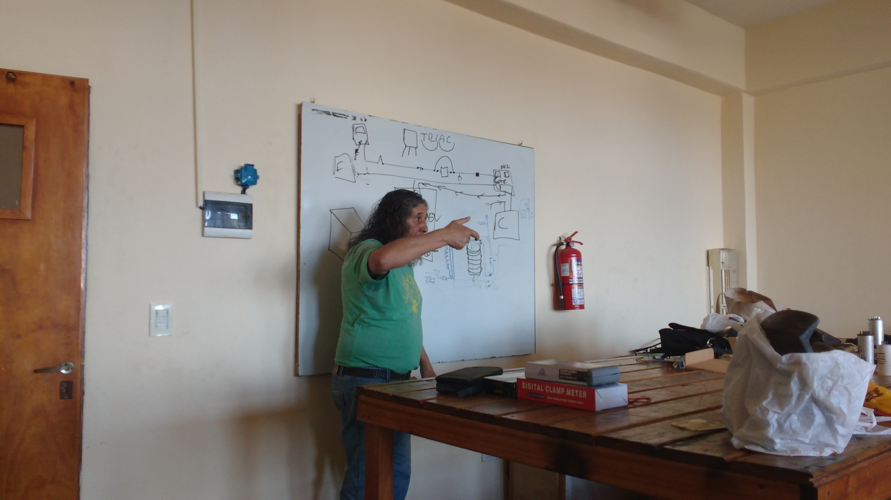
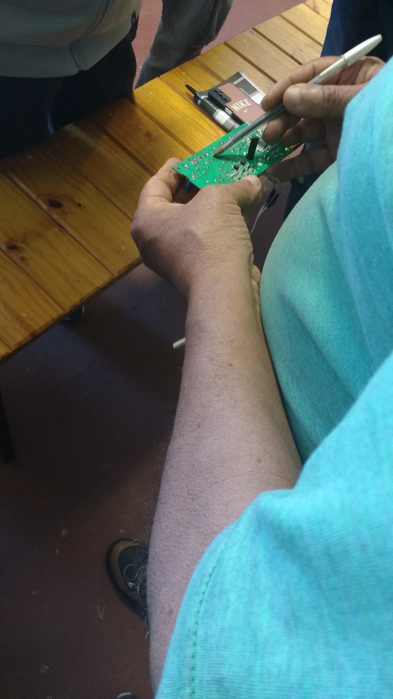
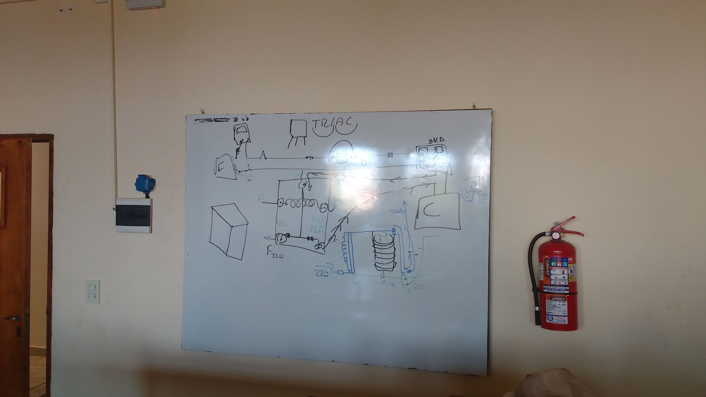
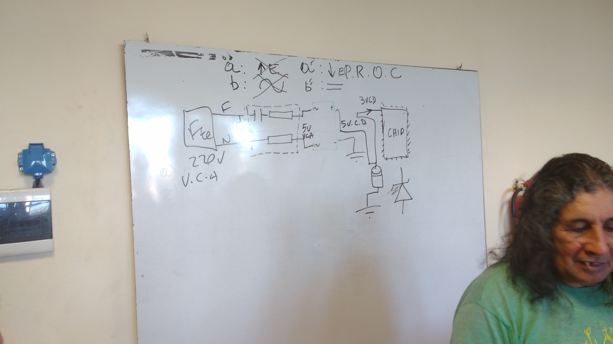
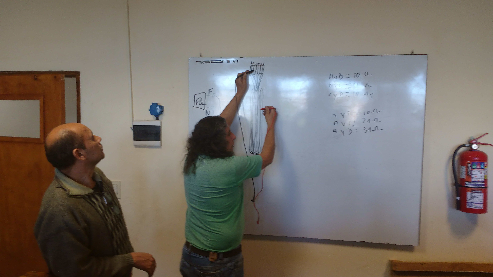
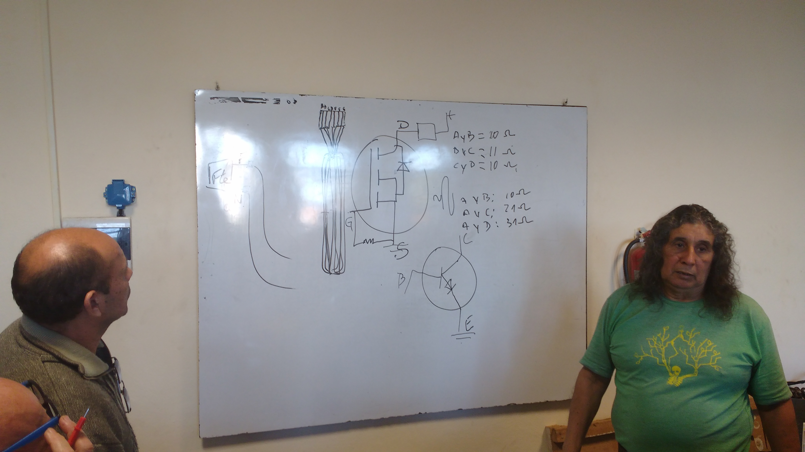
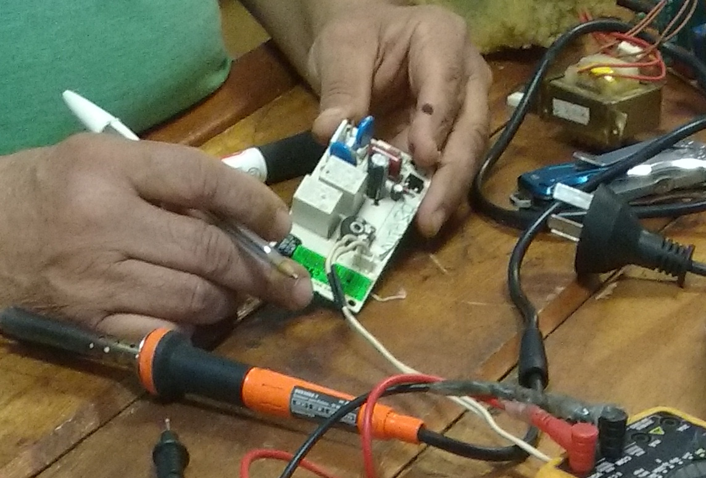
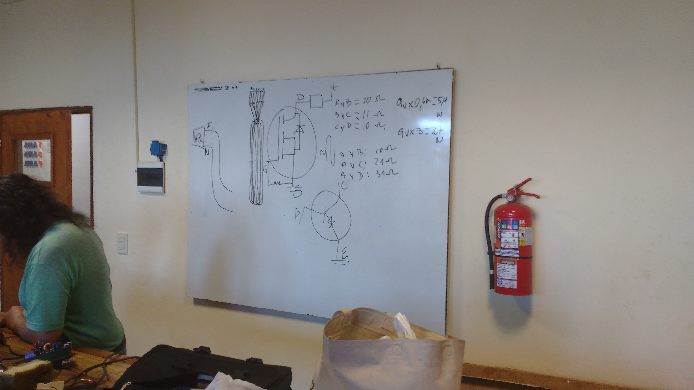

% Clase Nº 6: Relays, contactoras, varistores y protectores
% Andrés Imlauer
% 16 Julio 2024

#### Audio de la clase

[https://youtu.be/4LCbuu2Wa_4](https://youtu.be/4LCbuu2Wa_4)

[https://voca.ro/1m9YA0YHQNHw](https://voca.ro/1m9YA0YHQNHw)

#### O miralo en una instancia de invidious:

[https://redirect.invidious.io/watch?v=4LCbuu2Wa_4](https://redirect.invidious.io/watch?v=4LCbuu2Wa_4)

### **Problemas comunes en placas electrónicas y fuentes**

* En televisores, ciertos **circuitos integrados fallan por temperatura**, generando problemas recurrentes.
* **Consumo eléctrico = potencia**; siempre hay que tenerlo en cuenta al medir o dimensionar.
* La **fuente siempre necesita dos conductores**: fase y neutro.

***

### **Diagnóstico inicial**

* Lo primero que hay que medir es **continuidad**.
* Los elementos en **paralelo** (switch, pulsador) no cortan la continuidad a menos que haya un corto.
* La **continuidad se rompe en serie**: si un componente falla, todo el circuito se interrumpe.
* Todas las partes que controlan el trabajo suelen estar en **serie**, por eso la continuidad es clave.
* **Conexión directa**: si algo funciona conectado directo, el problema está en la placa o control.

***

### **Componentes y su función**

* **Resistencia → carga**
* **Capacitores → potencia**
* Muchos problemas en **plancha, microondas, secador, licuadora** están en la **fuente o la parte de potencia**.

***

### **Partes de la placa y alimentación**

* La placa tiene dos secciones:

  1. **Control**: trabaja con bajos voltajes (\~3-9 V).
  2. **Potencia**: trabaja con 220 V para alimentar la carga.
* El paso de los **220 V a la carga** puede ser mediante:

  * **Relé / relevadores**
  * **Triac** si no hay relé

***

### **Relés y Triacs**

* **Relé:** funciona por **magnetismo**, activado por bajo voltaje de la placa.
* **Triac:** transistor para corriente alterna.
* **Diac:** rectificador controlado, usado antes para corriente continua.
* Nota: Si la placa da 9 V y el relé es de 30 V, no se dispara.
* En potencia se encuentra principalmente **relé y triac**.

***

### **Notas de placas switching**

* Placas **switching** no manejan voltaje alto; trabajan con **corriente continua hasta 30 V** (como placas de PC).
* La diferencia entre placas **lineales y switching** afecta cómo se entrega la potencia y el control.

***

Si querés, puedo hacer un **diagrama visual simple** que conecte **control → relé/triac → potencia → carga**, para que quede todo clarísimo de un vistazo. Esto suele ayudar mucho para memorizar diagnóstico y fallas. ¿Querés que lo haga?

Aquí tienes un **resumen organizado y destacado** de los puntos más importantes de tu texto:

***

### **1. Relés y contactoras**

* **Relay:** elemento de control en la parte de potencia.

  * Se chequea midiendo la **continuidad de la bobina**.
  * Tiene pines **normalmente abierto (NA)** y **normalmente cerrado (NC)**.
  * Funciona por **magnetismo**.
  * Ejemplo de conexión: 220 V entre pines 1, 4 y 5.
* **Contactora:** relay para **múltiples funciones**, usada especialmente en **trabajos trifásicos** para proteger motores y evitar zumbidos o sobrecargas.
* **Triac:** transistor para **corriente alterna**, sin magnetismo.

***

### **Protecciones y varistores**

* **Varistor:** protege de **sobretensiones**.

  * Colocado en **paralelo** al circuito.
  * Funciona como **PTC o NTC** según coeficiente térmico:

    * PTC: si sube tensión → aumenta la resistencia.
    * NTC: si sube tensión → disminuye la resistencia.
  * Su resistencia es muy alta normalmente (\~1.180.000 Ω), por lo que **la electricidad “no lo siente” hasta una sobretensión**.

***

### **Osciladores y fuentes con MOSFET**

* En fuentes de computadora:

  * La **CC de 311 V** del capacitor va a la bobina del primario.
  * Para proteger la placa, pasa por un **MOSFET** que controla la entrada al oscilador.
  * Componentes clave en la fuente: **puente rectificador, capacitor, chopper, oscilador, MOSFET**.
  * Si el MOSFET está dentro del chip integrado, **hay que cambiar todo el integrado**; si está afuera, solo se cambia el MOSFET.
* Nota: un **capacitor en corriente continua no puede trabajar en serie**, equivaldría a un circuito abierto.

***

### **Diagnóstico de aparatos eléctricos**

* **Problemas comunes dependen de la marca** y condiciones ambientales.

  * Ej.: ciertos televisores o lavarropas tienen fallas repetitivas conocidas.
* Para motores y aparatos con partes mecánicas:

  * Revisar **rulemanes, bujes, ejes** según el ruido o fallo.
  * Ej.: lavarropas de carga superior que hace ruido → desarmar transmisión, aflojar tornillo, revisar.
* Siempre medir **consumo (potencia)** antes de cualquier diagnóstico.

***

### **Principios eléctricos básicos**

* Una **carga necesita fase y neutro** para funcionar con corriente alterna.
* **Continuidad:**

  * Se verifica primero para detectar fallas.
  * Se rompe en **serie** si un componente falla.
  * No se afecta por elementos en **paralelo**, salvo que haya corto.
* **Elementos en serie:** si uno falla, todo deja de funcionar.
* **Elementos en paralelo:** fallos individuales no afectan al resto, excepto cortocircuitos.

***

Si querés, puedo hacer un **diagrama tipo “mapa de control y potencia”** que conecte: **placa → relay/triac → motor/carga → protecciones → continuidad**, para que se vea todo de un vistazo y ayude a memorizar cómo diagnosticar problemas en aparatos eléctricos.

¿Querés que lo haga?

Aquí tienes un **resumen de examen** con los puntos clave de tu texto, organizado de forma clara y directa:

***

### **1. Comprobación de continuidad**

* Primero verificar: **switch, pulsador, térmico, fusible**.
* Herramienta: **tester en escala de continuidad**.
* Procedimiento:

  1. Cerrar la llave del switch, dejar pulsador conectado.
  2. Desenchufar y hacer puente si es necesario (ej.: termostato).
  3. Colocar tester en ambas puntas para medir continuidad.

***

### **2. Diagnóstico de resistencias y bobinas**

* **Resistencias de elementos de trabajo** (plancha, jarra eléctrica):

  * No pueden quedar en corto.
  * Impedancia nueva y usada debe ser casi igual.
  * Valores muy bajos pueden indicar fallo de tester.
* **Bobinas de motores o ventiladores:**

  * Cada bobina es **individual** gracias al esmalte del alambre.
  * Si el esmalte se quema, bobinas se unen → **resistencia baja**, cortocircuito interno.
  * Ej.: ventilador nuevo 18 Ω, quemado 3-5 Ω.
  * Nunca usar cable demasiado grueso que reduzca vueltas disponibles.

***

### **3. Medición directa**

* Si resistencia funciona, se puede **conectar carga en directo**, control manual:

  * Funciona pero **sin control** (ventilador, compresor).
  * No aplicar directo a componentes electrónicos que trabajan a menor tensión que 220 V → explota.

***

### **4. Fallas en fuentes de equipos electrónicos**

* **70% de los problemas** provienen de la **fuente**, porque soporta toda la carga del circuito.
* Transformadores:

  * Se quema casi siempre el **bobinado primario**, nunca el secundario (salvo humedad, cortocircuito o golpes).
* Función de la fuente: **adaptar la fuente a la carga**.

***

### **5. Fusibles**

* Siempre se colocan siguiendo la **capacidad del conductor**, no solo la carga:

  * Ej.: circuito consume 5 A, conductor soporta 2 A → fusible debe ser 2 A, no 5 A.
  * Si el fusible es mayor que el conductor → conductor se quema antes que el fusible.
  * Si fusible es adecuado → protege conductor y evita incendio.

***

### **6. Principios eléctricos básicos**

* Medición de **continuidad** primero para diagnosticar.
* **Conectar directamente** solo si se sabe que la carga soporta 220 V y no hay control electrónico de tensión.
* **Cargas en serie**: falla de un componente → circuito interrumpido.
* **Cargas en paralelo**: falla de un componente → circuito sigue funcionando, salvo cortocircuitos.

***

Si querés, puedo hacer un **esquema paso a paso de diagnóstico de continuidad y pruebas directas** que sirva para **examen práctico**, donde quede claro qué medir primero, cómo medir y cuándo poner directo. Esto suele ayudar mucho para memorizar.

¿Querés que haga ese esquema?

Aquí tienes un **resumen organizado de los puntos clave sobre fuentes, relés, TRIAC y bobinas** que mencionaste:

***

### **1. Fuentes de alimentación**

* **Fuente lineal:**

  * Trabaja con la **frecuencia de la línea** (50 Hz).
  * Utiliza **transformador de hierro al silicio**, que se **magnetiza y desmagnetiza rápido** según los ciclos de la red.
  * Adaptación: convierte 220 V AC a voltajes bajos (ej.: 3 V DC para chips).
  * Problemas comunes: casi siempre están en la **fuente** o en la **parte de potencia**.
* **Fuente switching (conmutativa):**

  * Trabaja a **frecuencias muy altas** (10.000–100.000 Hz).
  * No se puede usar hierro al silicio, se usan **núcleos de ferrita**.
  * Permite reducción de tamaño y potencia más alta que lineal para voltajes >90 V.
* Otros tipos: **capacitiva, resistiva**.

***

### **2. Relés y TRIAC**

* **Relay:**

  * Dispara carga mediante bajo voltaje de control (ej.: 9 V).
  * Peligro: si se usa un relay de 30 V con control de 9 V → no funciona; si es de trabajo continuo, **se quema la bobina**.
  * Tiene 5 pines (entrada de energía, control y salida de carga).
  * Genera un **campo magnético** al energizar la bobina, moviendo el émbolo hacia arriba o abajo.
* **TRIAC:** transistor para **corriente alterna**, reemplaza al relay donde no hay relevadores.
* **DIAC:** rectificador controlado de silicio, usado inicialmente para corriente continua, funciona como conmutador.

***

### **3. Bobinas y funcionamiento magnético**

* **Función de la bobina:** generar **campo magnético**.
* Con émbolo ferroso dentro del campo:

  * El émbolo se mueve según la **polaridad y orientación del bobinado**.
  * Invertir polaridad → el émbolo se mueve en dirección contraria.
* Aplicación:

  * Relés, motores, solenoides.
  * Fuerza generada depende de número de vueltas del alambre y del material del núcleo.

***

### **4. Adaptación de voltajes**

* La **fuente lineal** adapta la tensión de línea (220 V AC) a la requerida por la **placa o chip**.
* Debe respetarse el voltaje nominal de relés y cargas:

  * Ej.: relay de 9 V no puede recibir 30 V de placa switching.
* La parte de potencia siempre se encuentra **desacoplada de la parte de control**.

***

Si querés, puedo hacer un **diagrama visual tipo “fuente → relé/TRIAC → carga”**, mostrando cómo actúa la bobina y el campo magnético, para entender mejor los relés y motores. Esto suele ayudar mucho para examen.

¿Querés que haga ese diagrama?

Aquí tienes un **resumen organizado y destacado** de los puntos clave sobre motores universales, relés, triac y bobinas que mencionaste:

***

### **1. Motores universales en lavadoras**

* Los motores de lavadoras son **universales**, funcionan tanto con **corriente continua como alterna**.
* La **rotación se cambia invirtiendo la polaridad** de la corriente que llega al motor.
* En lavadoras antiguas no se podía invertir la rotación porque no tenían **placa electrónica** que controle la polaridad.
* La placa genera **pulsos con dirección**, controlando la rotación del motor.

***

### **2. Relés y bobinas**

* La **bobina del relay** contiene un **émbolo ferroso** que se magnetiza al recibir corriente.
* Materiales ferrosos (hierro, acero) generan el campo magnético; cobre o bronce no.
* El **campo magnético mueve el émbolo**, venciendo la fuerza de un resorte que mantiene los platinos abiertos.
* **Platinos:** contacto que cierra y abre el circuito cuando se magnetiza el émbolo.
* Aplicaciones: motor reversible, solenoides, bombas.
* **Protección del triac:**

  * Un relay soporta alto voltaje y protege el triac.
  * Un fusible no protege eficazmente un semiconductor porque es demasiado lento.

***

### **3. TRIAC**

* Semiconductor de **corriente alterna**, usado en lugar de relé donde no se requiere fuerza mecánica.
* No puede ser protegido eficientemente con fusible; mejor usar **relay como protección adicional**.

***

### **4. Contactores**

* Similar al relay, pero **para múltiples aperturas y cierres**, usado especialmente en **trabajo trifásico**.
* También se puede usar en monofásica para controlar varias cargas simultáneamente.
* Funciona con **bobina y fuerza magnética**, cerrando y abriendo las cuchillas de contacto.

***

### **5. Funcionamiento eléctrico**

* Para que un relay cierre correctamente:

  * La **bobina debe recibir el voltaje nominal** (ej.: 12 V DC).
  * **Corriente continua**, no alterna.
  * Al quitar alimentación, el resorte abre los platinos.
* Los **extremos de la bobina** se etiquetan A y B.

***

### **6. Calidad de motores y ventiladores**

* La velocidad depende de la **cantidad de polos y espiras de la bobina**.
* Más bobinas, menos espiras → **motor de mala calidad**.
* Menos bobinas, más espiras → **motor de mejor calidad**.
* Ventiladores de techo tienen **reactor con bobina**, ventiladores de piso no.
* Bajando la velocidad de un ventilador, el motor calienta el plástico; térmico abre al calentarse.

***

Si querés, puedo hacer un **diagrama que conecte la placa, relay, triac y motor universal**, mostrando **cómo cambia la rotación del motor** y cómo actúan los platinos y bobina. Esto sirve mucho para memorizar para examen práctico.

¿Querés que lo haga?

Aquí tienes un **resumen organizado y paso a paso** de cómo probar un **relay de 12 V DC** según tu texto:

***

### **1. Condiciones para el relay**

* La **bobina del relay** necesita **12 V de corriente continua** para cerrar.
* Cuando se quita alimentación, el **resorte abre los platinos**.
* Al aplicar los 12 V DC, el **campo magnético vence la fuerza del resorte** y los platinos se cierran.

***

### **2. Medición inicial**

* Primero se mide **continuidad** con tester para verificar que la bobina no esté abierta o en corto.
* Se escucha el típico **“clic”** al energizar la bobina.

***

### **3. Fuente de prueba**

* Para probar el relay se puede usar:

  * **Transformador de 220 V → 12 V AC**, luego un **puente rectificador de 4 diodos** → capacitor para suavizar tensión → DC estable.
  * **Cargadores de herramientas eléctricas** (12 V, 19 V, 5 V, 9 V) porque el relay **consume muy poco**.
  * Una **fuente casera de 12 V DC**.

***

### **4. Procedimiento de prueba**

1. Conectar la bobina a la fuente de 12 V DC.
2. Observar que **el platino normalmente abierto (NA) se cierre** y el **normalmente cerrado (NC) se abra**.
3. Comprobar que el **campo magnético vence la fuerza del resorte**.
4. Verificar la salida:

   * Si se aplican 220 V a la entrada de fase → debe **pasar la corriente a la salida** cuando el relay está cerrado.

***

### **5. Notas importantes**

* Guardar **cargadores fundidos**: sirven como fuentes de bajo consumo para probar relays.
* Los relays no consumen prácticamente corriente, por lo que cualquier cargador con voltaje adecuado funciona.
* La prueba completa consiste en: **alimentar la bobina, observar cierre de platinos y confirmar paso de corriente de entrada a salida**.

***

Si querés, puedo hacer un **esquema visual del circuito de prueba de un relay de 12 V**, mostrando **transformador → puente rectificador → capacitor → bobina del relay → platinos NA/NC → carga**, para que quede todo clarísimo para examen.

¿Querés que haga ese esquema?

***

## Publicación original de Andrés Imlauer

**Título original:** [AUDIO][APUNTE] Taller reparacion electrodomesticos (Clase 6) - Relay. Triac: corriente alterna. Mosfet: continua y alterna?. Contactora. Varistor. Termistor. Fuentes. Puente Rectificador. Mosfet. Soldador no funcionó.

**Publicado:** 8 de agosto de 2024

<!-- Publicación original importada desde el tag electrodomesticos -->

#### Audio de la clase
https://youtu.be/4LCbuu2Wa_4

https://voca.ro/1m9YA0YHQNHw

O miralo en una instancia de invidious: https://redirect.invidious.io/watch?v=4LCbuu2Wa_4

##### Problemas comunes.

Placa electrónica de un televisor: tal circuito integrado no está aguantando, por problemas de temperatura muchas veces se repiten.

Consumo es la potencia.

Para la fuente tengo que tener dos conductores: fase y neutro.

Si yo tengo algo que no anda lo primero que tengo que medir es **continuidad**

Puedo tener un switch, un pulsador, si es algo que está en paralelo a no ser que esté en corto NO ME VA A QUITAR la continuidad.

Siempre mi continuidad se va a caer cuando yo tengo las cosas en serie, porque cuando las cosas están en serie tienen que funcionar todas porque 1 que no funcione, no funciona ninguna.

Todas las cosas que controlan el trabajo están en serie, por eso hay que medir la continuidad primero.

Si conecto directo el aire funciona.

Una bobina puede quedar en corto.

Resistencia: carga
Capacitores: potencia

Casi todos los problemas de planchita, microonda, secador cabello, liquadora, están en la fuente o en la parte de potencia.      

En la parte de potencia nosotros vamos a encontrar problemas con la parte que dan el trabajo a la potencia porque si esto es una placa, ya no es una carga se llama control y trabaja con 3 voltios. La carga va a trabajar con 220 voltios, quiere decir que esos 220 va servir para que una determinada parte de la placa haya una parte de fuente y por el otro lado haya una parte de alimentación de potencia que vamos a encontrar en la parte de alimentación para que funcione la potencia.

#### Preguntar 
#### Como llegan los 220 voltios (alimentación de potencia)
Por relé o relevadores.

Funcionamiento relé: 
https://www.youtube.com/watch?v=aHttlFviaDQ

https://www.youtube.com/watch?v=1ee8QlvUkr8

#### 43 minuto:
Tenía 2 placas, una lineal y otra switching.

Switching: no trabaja con voltaje alto, porque trabaja con corriente continua hasta 30 voltios porque es una placa de PC.

Cuando no hay relevadores hay un **triac**.

Triac: transistor de corriente alterna.

Primero apareció el diac: rectificador controlado de silicio, pero era para corriente continua, era como un conmutador.

La placa va a disparar tu relay con 9 voltios, y le pongo un relay de 30 voltios, los 9 voltios que dispara la placa no va a disparar el relay.

Vamos a suponer que es un relay unicamente de 1 pulso y terminó.

Los relay trabajan con magnetismo, los triac no. 

## En la parte de la potencia vamos a encontrar: relay y triac.

***

En la parte de potencia vamos a encontrar un relay.

TRIAC = transistor para corriente alterna.

Relay para chequear si funciona tenés que medir la continuidad de la bobina. En el relay tenés un pin que se llama normalmente abierto y en el otro normalmente cerrado.

De la misma manera vamos a encontrar las contactoras.

Una contactora es un relay para múltiples funciones de apertura y cerrado, y donde se vió la necesidad? En un trabajo trifásico. Corremos el riesgo de que una máquina un motor esté sufriendo un zumbido o cosa así.

### Relay
220 trabaja entre el 1, el 4 y el 5.

## Muchas placas no traen varistor.

El varistor trabaja porque varía la resistencia por la tensión, es un PTC O un NTC.

Coeficiente térmico positivo, 
Coeficiente térmico negativo, 

Si la tensión sube, el coeficiente térmico positivo la resistencia también sube.    
Si la tensión sube, el coeficiente térmico negativo la resistencia baja.

El varistor esta en paralelo y el tester debe estar en escala en ohm muy alta.

Varistor es una protección si tenés una sobre tensión se pone en corto.

1.180.000 de ohm. Es altísimo por eso la electricidad no se entera que él está.

Lo que más se jode de una fuente de computadora es el oscilador,

### Oscilador
La corriente continua de 311 voltios salía del capacitor venía directamente a la bobina del primario el extremo de la bobina del primario tiene que venir al chip pero va a quemar porque tiene 311 voltios, entonces pasa por un MOSFET, la que entra al mosfet que es la otra parte del neutro va a la otra patita y por el del medio va la oscilación del chip.

#### 02:27:50
La entrada de los 220, el puente rectificador, el capacitor, vamos a encontrar el chopper, el oscilador y el mosfet. El nuevo chip el mosfet ya no está ahí está adentro.

Cuando el mosfet está afuera lo cambiamos, si está adentro hay que cambiar todo el integrado.

Un capacitor en corriente continua no puede trabajar, no puedo poner un capacitor en corriente continua en serie es como si estuviera abierto el circuito.

***

#### Transcripción

##### Cual es el problema más común de los televisores?
Depende de la marca de televisores hay problemas comunes.

Profesor: "Mi profesor me dijo que nunca son iguales los problemas, pero se equivocó muchos los problemas dependen de la marca, hay ciertos lavarropas y ciertos televisores que se sabe de entrada cual es el problema que tienen".

Tal aire acondicionado si presenta tal problema cambiale el valor de tal cosa, en tal parte. Esos problemas se repiten.

Vamos a hablar de la placa electrónica de un televisor, está dejando de funcionar tal cosa es porque tal circuito integrado no está aguantando, o está aguantando en donde hace frío cerca de 0 pero en los lugares subtropicales está fracasado.

Todas las herramientas son buenas. Hay que insistir con la parte electrónica magnética.

Si tiene rulemán entonces el ruleman.
Si tiene buje y eje entonces es eso.

Si es un lavarropas de carga superior y hace ruido, hay que desarmar la transmisión aflojar tornillo y sacarlo y listo, pero los técnicos fracasan en donde yo sigo mis clases, para la mayoría le cuesta mucho entender esto.

O vos le llevás y te dicen a si es un capacitor ese, pero hay veces que alguien por el camino le cambió el capacitor y ellos ya **no saben**.

Porque a mi me pueden traer un motor con un problema, lo primero que voy a hacer es **medir el consumo**, ¿por qué mido el consumo? 
#### ¿qué es el consumo?
**La potencia**
#### Por qué es la potencia?
Porque yo la tensión ya tengo, si yo acá tengo una carga acá tengo la fuente quiere decir que yo si o si tengo que tener dos conductores vamos a hablar de corriente alterna porque si no no funciona.

Esos conductores se llaman **fase y neutro**. Sin fase y neutro no va a funcionar nunca, si yo tengo algo que no anda, inmediatamente tengo que hacer un **control de continuidad**.

Por acá puedo tener un pulsador, puedo tener un switch, **si es algo que está en paralelo a no ser que esté en corto no me va a quitar la continuidad, siempre mi continuidad se va a caer cuando yo tengo las cosas en serie**.

Todas las que están conectadas en serie tienen que funcionar, porque 1 que no funcione ya no anda nada.

Si el cable se soltó internamente, ya no va a andar.

Si se rompió algo que está en paralelo.

Todas las cosas que controlan el trabajo, siempre van a estar en serie. Con que 1 no me funcione ya no funciona nada.

## Respuesta exámen
#### Tengo que hacer una comprobación de continuidad entonces primero voy a verificar el switch, pulsador, térmico, fusible.

Directamente que puedo hacer?

Agarro el tester y mido la continuidad.

Entonces una de las formas es medir acá, en la clase anterior habíamos medido una jara eléctrica, medimos la resistencia.

Porque si la resistencia no funciona, ¿para que quiero ver el resto de los componentes?

Si me anda la resistencia, yo voy a poder trabajar de forma directa, pero voy a tener que estar al lado controlando.

No voy a poder hacer ningún tipo de control porque está conectado directamente: cuando enchufo arranca, cuando hace frío desconecto, pero de que va a funcionar funciona.

Mi ventilador lo voy a poner en directo. 

### Siempre y cuando no sea un **reductor de voltaje**.
Porque si tengo un componente que trabaja en menos de 220, y yo le pongo 220 hace explotar todo.

Si es algo electrónico que está ahí controlándome la tensión no voy a poder sustituirlo, pero lo otro sí puedo poner en directo.

El ventilador, el compresor en directo todo funcione, no voy a tener control hasta que compre una placa nueva.

Habría que hacer una medición de continuidad: cierro la llave del switch dejo conectado el pulsador.

Yo desenchufo y hago un puente, vamos a suponer que sea un termostato, **puenteo** y ahí si me quedó directa la carga. Yo coloco el tester en ambas puntas en la escala de continuidad.

Si me mide que está hecha la continuidad y no funciona hay otro problema, ¿cuál puede ser el problema?

Vamos a suponer que sea un ventilador.

Una de las bobinas está en corto, por eso **me da continuidad**, si yo mido un ventilador y me dá 37 ohm de impedancia cuando está en corto me va a dar 20/15/11, porque en algún lado los cables dejaron de estar aislados.

Si es una plancha no puede haber variación entre la nueva y la usada tiene que ser la misma impedancia, la resistencia del elemento de trabajo es tan corta que no habrá problemas siempre marcará 0, algo. 

Pero por el problemas del tester a lo mejor me va a marcar 1 o 2 ohm , o no me va a marcar nada.

**No puede quedar en corto la resistencia de la plancha.**

Lo mismo la resistencia de la jarra eléctrica, **lo que si me puede quedar en corto es una bobina, porque las bobinas son individuales cada bobina, y son individuales gracias al esmalte del alambre: CABLE MAGNETO**. 

No podemos usar un cable grueso porque a la segunda vuelta ya no tenemos más espacio.

Una bobina nueva me puede estar rindiendo 18 ohm, y si está quemada me marcará 5/4/3 ohm, porque en algún lado el esmalte se borró y se UNIERON las bobinas, y corta camino en lugar de hacer el recorrido completo.

Alumno: a mi me pasó con un ventilador industrial, se juntaron los cables y yo re manija, metí más cable y reventó todo.

Profesor: pero aprendiste, si te enojás y pateás perdiste tiempo.

En una fuente para un equipo electrónico, por lo general lo que más deja de funcionar es la parte de la fuente, el 70% más o menos de los componentes electrónicos siempre se queman la fuente.

**Por qué?**

Porque es la que soporta mayor el trabajo, todo el trabajo que hace, todos los trabajos que hacen toda la cantidad de cosas que están acá dentro soporta la fuente.

La que soporta todo el trabajo es la fuente, igual que los transformadores el que soporta todo el trabajo es el bobinado primario.

**Cuando un transformador se quema el 99% se quema el primario.**

Nunca encontré un transformador quemado el secundario, aunque puede pasar por la humedad, o una cucaracha o se golpeó algo.

**Si hay un corto en el secundario se quema el primario**, porque es el que soporta la carga, el secundario consume, cuando analicen transformadores quemados, siempre está achicharrado o de color quemado, el bobinado primario, a veces se corta porque es demasiada la carga que soporta.

Los fusibles deben estar puestos siempre mirando al conductor que le llega hasta el fusible. Si yo tengo puesto un fusible acá, tengo que mirar de acá para allá, lo correcto es el completo. Acá es donde se resiente el conductor.

El fusible siempre debe ponerse de acuerdo a la medida del conductor, o sea que este circuito a mi me está gastando 5 amper, yo tengo que colocar acá NO un fusible de 5 amper, **si yo acá tengo un cable para dos amper yo voy a poner un fusible de 2 amper NO uno de 5.**

"Eh, pero no voy a poder usar, apenas uso 5 minutos y vuela, bueno está bien, querés usar completo cambiá el conductor, poné conductor para 7 amper para 6 amper, una vez que colocás un protector para 6/7 amper, **el que no va a soportar nunca es el conductor**.

Si yo coloco un conductor para 3 amper y hay un consumo de 7 y coloco un fusible de 7 amper, **pero el conductor no va aguantar**. Va a prender fuego, es preferible que el fusible vuele todas las veces porque el conductor ya viene hasta que vos digas **voy a poner un cable como tiene que ser porque no va**.

#### El fusible siempre debe ponerse a la medida del conductor.

### La funcionalidad de la fuente es adaptar mi fuente a la carga.

Por qué se llama fuente lineal? Porque trabaja con la frecuencia de la línea.

Tipos de fuente: capacitiva resistiva, lineal, switching o conmutativa.

Si yo tengo un chip de 3 voltios de voltaje directo, en la fuente tengo 220, entonces tengo que adaptar la fuente a los voltajes del chip.

## Por qué nosotros decimos que una fuente es lineal?
Porque trabaja a 50 ciclos.
Como es un transformador para 50 ciclos? Con núcleo de hierro al silicio.

Hierro al silicio porque se magnetiza y desmagnetiza dentro del tiempo 50 ciclos por segundo.

La fuente switching no se puede poner un transformador de hierro porque trabaja a 10.000 hasta 100.000 ciclos.

Entonces quiere decir que se magnetiza y desmagnetiza mucho más rápido, **si fuera hierro al cromo tampoco sirve** porque se magnetiza y queda magnetizado como pasa con la punta de los destornilladores.

Se inventó la fuente lineal porque trabaja con la frecuencia de la línea.

Que es lo que le hace que el hierro al silicio se desmagnetice? Porqué yo magnetizo esto y se desmagnetiza otra vez, y por qué el hierro al cromo se magnetiza y queda.

Estoy hablando del metal, la particularidad del metal.

**Porque en el hierro al silicio las partículas magnéticas están desorientadas, no están en fila. En el hierro al cromo sí.**

En el hierro al silicio las partículas magnéticas están desorientadas, no están en fila, en el hierro al cromo sí.

No se hacen ferrita para los transformadores lineales por la frecuencia, son muy acelerados.

Un transformador de ferrita ya se pone a trabajar a partir de los 90 voltios para arriba, llega a tener la potencia de un transformador lineal.

### Casi todos los problemas estarán en la parte de la fuente, o en la parte de potencia
En la parte de potencia vamos a encontrar problemas con la parte que dan el trabajo a la potencia.

### Que vamos a encontrar en la parte de alimentación para que funcione la potencia?
Relé, relay, relevador.

En donde no tenemos relé vamos a encontrar TRIAC.

TRIAC: transistor de corriente alterna.
**El que primero apareció era el DIAC:  rectificador controlado por silicio.**
Sólo para corriente continua, como un conmutador.

Vamos a suponer que la placa va a disparar el relay con 9 voltios y yo le pongo uno de 30 voltios, los 9 voltios que dispara la placa no va a disparar el relay, si le ponés una fuente switching en vez de liineal.

### Vamos a suponer que es un relay únicamente de 1 pulso y terminó, si yo acá tengo un relay de 9 voltios y me dispara 30, no va a pasar nada.

### Pero si es un relay de trabajo continuo sí. Por ejemplo para la bomba punzora, todo ese tiempo que trabaja la bomba se va a quemar el bobinado, porque era para 9 voltios y la placa le está dando 30, se quemará la bobina del relay.

El relay tiene 5 pines. Está hecho para 5 pines, muchos relay traen 4 pines porque hay 1 que le sacan.

Cuando van a comprar le van a dar con 5 pines. O agarran un alicate y lo cortan. **Porque es el que no tiene circuito, los demás sí.**

El 1 es la entrada de energía: 220 voltios.
Necesito los 220 para que la carga funcione.

**Si es bomba de agua, solenoide de carga trabaja con TRIAC.**

### bobinas = generan campo magnético

Para que sirve la bobina? Generan campo magnético, dentro del campo magnético si yo coloco un émbolo ferroso que ocurre? Vamos a suponer que yo tengo un molde de plástico de cartón o de lo que sea, y le entro a enrollar acá alambre. Si yo conecto estas dos puntas a 12 voltios de corriente directa, que va a ocurrir? Se va a crear un campo magnético, será constante.

Polo norte, polo sur y se va a ir variando.

Depende de como este hechas las vueltas del alambre, el émbolo de hierro o va a saltar para arriba o para abajo.

Crea una fuerza magnética que le hace correr al émbolo, entonces este relay.

Para que el émbolo vaya hacia arriba o hacia abajo hay que invertir la polaridad.

Me quedé en el minuto 51.

O sino puedo desarmar todo el bobinado y envolver al otro lado. De acuerdo a como esté hecho el bobinado genera la fuerza hacia arriba o hacia abajo.

El positivo de un lado y el negativo del otro.

Esto ocurre en los motores. 

Lo único que hacemos es invertir el lado por donde entra la corriente, por eso las lavadoras con placas son motores universales, trabajan con continua, como alterna.

La placa está generando un sistema de pulso con dirección por eso cambia la rotación, en los lavarropas viejos no se podía porque no tenía una placa que le haga cambiar la polaridad.

Lo único que hacemos es invertir el lado en donde entra la corriente, los motores de las lavadoras son motores universales.

El relay tiene una bobina, dentro de la bobina tiene un émbolo un hierro que no está asegurado. Acá vamos a tener un émbolo que pasará por dentro y generará una base rígida. Esto genera un campo magnético que magnetiza al émbolo, porque el émbolo es ferroso. El cobre y el bronce no se magnetiza, únicamente me sirve los materiales que son ferrosos.

Si no se puede mover genera una fuerza magnética pero queda firme porque está abulonado a la chapa.

Platinos que cierran y abren.

Cuando la chapa se magnetiza, lo hace con 12 voltios.    
Cuando la placa magnetiza la bobina, el platino se cierra, por lo general es un resorte para que el platino esté siempre abierto. Cuando se magnetiza el campo magnético que está acá tiene que vencer la fuerza del resorte.

Termostato de la plancha tiene un platino, es un material más firme que permite que fogonazo de la corriente.

El platino cuando la placa ordena el platino se cierra, y como tengo una entrada de 12 voltios.

El relay hace que el motor pueda girar en ambos sentidos porque conecta la bobina al reves.

Mi padre agregó un relay para proteger el triac.
Proteje porque el relay es más duro para resistir alto voltaje o alto voltaje, si se pone en corto va a saltar el fusible.

Si le agregás el fusible al triac, el fusible es muy lento y se caga antes el TRIAC.

### El semiconductor triac no aguanta, nunca podés proteger a un semiconductor con un fusible, el fusible es lento.

Pusieron un potenciómetro lineal para saber la posición de la mariposa o acelerador en un BMW. Cuando pusieron electrónica, porque le tenían que saber donde estaba el acelerador y eso traía mucha falla. Y en Inglaterra con fue sustituido con efecto hall, valía 200 dólares la reparación.

Cuando vos usas el ventilador baja velocidad calienta el plástico.

El térmico cuando se calienta abre y no funciona más no es como un termostato.

Los ventiladores son más lentos porque el motor es de mala calidad. En un motor la velocidad está dada por la cantidad de polos, cuanto menos polo tiene un ventilador más velocidad. Los polos hacen un electroimán.
Está hecho con la cantidad de espiras necesarias.

Mas bobinas menos espinas = mala calidad   
Menos bobinas más espinas = mejor calidad    

El ventilador de piso no tiene bobina en el reactor, pero el de techo sí.

### En la parte de la potencia encontraremos relay y triac

Al mirar el relay lo primero que haceos es medir continuidad de la bobina. En el relay tenemos un pin que se llama normalmente abierto y otro que se llama normalmente cerrado, por lo general este pin no aparece con la letra A aparece con la letra O.

En los relay vamos a tener dos tipos de corriente siempre y cuando sea un relay que está trabajando en un motor, de la misma manera vamos a encontrar en las contactoras.

Las contactoras son iguales que los relay para multi apertura y cerrado, se vió la necesidad en un trabajo trifásico. Con una sola funcion la contactora conecta las 3 funciones o 4 o 5. 

Una contactora se puede usar en una monofásica también.
Incluso si yo estoy haciendo un trabajo para mí puedo usar una contactora para prender varias cosas a la vez.

No es nada más que unas cuchillas que se abren y usa una fuerza magnética. 

Si esto fuera una contactora en uno de estos lugares tendría que ver una conexión para la bobina, porque tengo que alimentar la bobina para que cierre el contacto cuando yo largo la fuerza de mi resorte abro.

El relay va a abrir y funcionar a través de una fuerza magnética tenemos que estar atento al voltaje con que nosotros vamos a disparar la fuerza del relay.

01:10:30

El relay va a abrir y cerrar a través de una fuerza magnética tenemos que estar atentos al voltaje con que nosotros vamos a disparar la fuerza del relay.

A y B son los extremos de la bobina, en los extremos tiene que haber 12 voltios de corriente continua, no me sirve 12 voltios de corriente alterna tiene que ser corriente continua para que el relay cierre y cuando le dejamos de alimentar sube porque el resorte le abre, y cuadno le doy los 12 voltios el campomagnetico vence la fuerza del iman y los platinos se toman.

Nosotros

En los extremos de la bobina tiene que haber 12 voltios de corriente continua, para que el relay cierre y cuando le dejamos de alimentar el sube porque el resorte le abre y cuando yo le doy los 12 voltios el campo magnético vence la fuerza del imán y los platinos se tocan.

Medimos unos de estos relay y se escucha el tiqui, yo mido la continuidad primero luego con una fuente de 12 voltios con un transformador que va a transferir la corriente de 220 voltios a 12, que por lo general andará entre los 15 y 16 voltios, que le sigue después de eso?

Tiene que ser un transformador de hierro, luego del transformador sigue un puente rectificador o sea que yo voy a tener 220 voltios, voy a tener 15 16 voltios de corriente alterna en el transformador.

Voy a hacer un puente rectificador con 4 diodos

Le sigue un capacitor para dejarlo mejor a la tensión, ahí ya podemos probar si el relay funciona on o.

Cualquier cargador de herramientas eléctricas de 19 voltios o de 12 voltios podemos probar relay con eso, porque el relay no tiene consumo.

Cualquier cargador de herramientas eléctricas de 19 voltios o de 12 voltios podemos probar relay con eso, porque el relay no tiene consumo.

Guarden los cargadores que se les fundió el cable porque les puede servir para medir relay.

Hay de 5 voltios, 9 voltios, 30 voltios.

El celular solo tiene 5 voltios, el de la carga para la batería tiene 19 voltios.

O nos hacemos una fuente de 12 voltios y podemos medir con eso..

Ahora vamos a ver si está habilitado el paso de la corriente

Si entra la fase de los 220 voltios.

Si yo le mando los 12 voltios va a abrir el normalmente cerrado, pero va a cerrar el normalmente cerrado

Que quedaría por probar? Si la corriente que entra esté saliendo.
