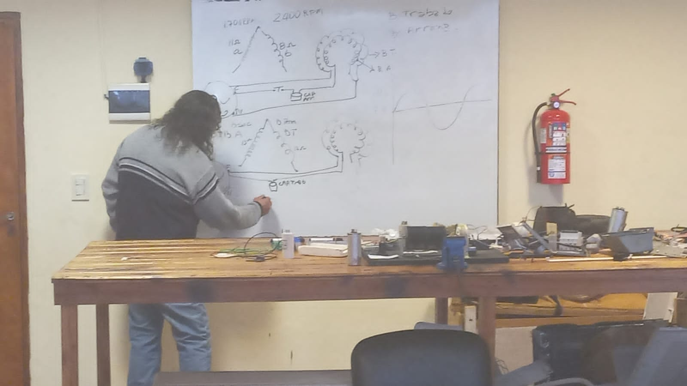
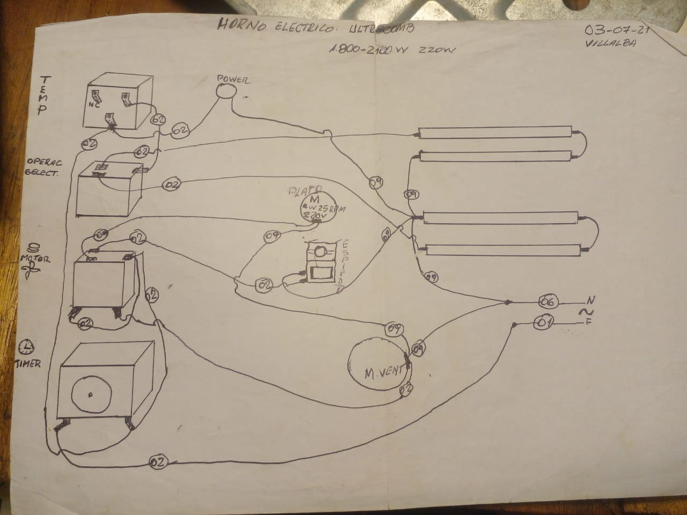

% Clase Nº 7: Horno eléctrico, selector de velas y termostato
% Andrés Imlauer
% 16 Julio 2024

#### Audio de la clase

[https://youtu.be/5RjcuVO6T3I](https://youtu.be/5RjcuVO6T3I)

[https://vocaroo.com/18EtH3Rz0QA3](https://vocaroo.com/18EtH3Rz0QA3)

### O escuchala en invidiuos

[https://redirect.invidious.io/watch?v=5RjcuVO6T3I](https://redirect.invidious.io/watch?v=5RjcuVO6T3I)

### 1. **Funcionamiento de un aire acondicionado y heladeras**

* Los caños de los evaporadores suelen ser de **aluminio**, lo que los hace sensibles a la humedad.
* Arreglar caños de aluminio con poliuretano es **poco recomendable**, porque se deterioran rápido y deja la impresión de mal trabajo.
* Lo recomendable es **tomar las medidas del evaporador** y comprar uno nuevo (tipo freezer) en casas de repuestos especializadas.

***

### 2. **Seguridad en mediciones eléctricas**

* Tener **mucho cuidado al medir 220 V** con tester.
* No usar la función de continuidad para medir 220 V, porque **se puede dañar el tester**.

***

### 3. **Reparación de hornos eléctricos**

* Lo ideal es **cambiar las dos velas resistivas** al mismo tiempo:

  * Evita que el cliente se queje si la otra se quema.
  * Cubre al técnico en caso de fallas posteriores.
  * Las velas viejas se pueden guardar como repuesto temporal.
* Las resistencias son **dos cuerpos unidos** mediante un conductor de fibra de vidrio para soportar temperatura.
* Si no se pueden comprar por separado, hay que comprar **la vela completa y unirlas con una chapita**.

***

### 4. **Gestión de repuestos**

* Siempre llevar **la mejor pieza** para pedir repuesto y asegurarse de que tenga la misma medida.
* Al pasar presupuestos, incluir **ambas velas** para minimizar problemas futuros.
* Informar al cliente sobre la **posibilidad de que la otra vela se queme** si decide no cambiarla.

***

Si querés, puedo hacer un **resumen todavía más compacto en “tips prácticos”**, para que te quede listo para estudiar rápido o llevar al taller. ¿Querés que haga eso?

Acá te hago un **resumen de los puntos más importantes** del nuevo bloque de texto:

***

### 1. **Velas de horno**

* **No se pueden usar solas**: se necesitan ambas velas juntas para soportar 220 V.
* Si una vela vieja no calienta y las dos nuevas sí, el problema está en el **selector de velas**.
* Para reemplazo de evaporadores o resistencias, **tomar la medida exacta** y comprar el repuesto adecuado (nadie hace la serpentina nueva como se hace en teoría).

***

### 2. **Motores y funcionamiento**

* El **temporizador controla al termostato**.
* En motores, a veces **el rulemán está bien pero la estrella está rota**.
* **Motores universales**: se pueden probar con 12 V, tienen delgas y necesitan carbones.
* Motores controlados por pulsos **no necesitan capacitor** si tienen una sola bobina.
* La bobina de arranque es la que **tiene mayor resistencia (ohm)**.
* Si un motor necesita ayuda para arrancar, **se puede usar un capacitor de arranque**, incluso si originalmente no lo tiene (como en heladeras o splits).
* El capacitor puede conectarse **antes o después del relay**, sin que afecte el funcionamiento.

***

### 3. **Recomendaciones prácticas**

* Comercialmente no conviene “forzar” motores con capacitores, porque puede acortar la vida útil del motor.
* Para uso propio o casos especiales (como una heladera sobrecargada), **sí se puede colocar un capacitor de arranque temporal**.

***

Si querés, puedo combinar **estos dos bloques que me mandaste** y hacer un **resumen final ultra conciso**, con todo lo importante sobre velas, evaporadores, motores y seguridad eléctrica, para tenerlo listo como guía de taller. ¿Querés que haga eso?

Acá te hago un **resumen organizado y destacado** de este último bloque sobre bobinas, capacitores y motores:

***

### 1. **Capacitores en motores**

* Los **capacitores de arranque** se usan para corregir el **desfase** entre corriente y voltaje en motores con bobina de arranque.
* Los **capacitores de trabajo** mantienen el motor en fase durante operación normal.
* Diferencias visuales:

  * Arranque: negro o azul, generalmente dice “capacitor de arranque”.
  * Trabajo: blanco o metálico, no siempre indica su función.
* **Capacitor = condensador**, son lo mismo.
* La **bobina de arranque** casi siempre está por fuera; la de trabajo, por dentro.
* La bobina de arranque **requiere un relay**; la de trabajo, no necesariamente.

***

### 2. **Determinación de bobinas**

* Cada bobina tiene **un principio y un final**.
* Para identificar arranque y trabajo:

  * Medir resistencia de las bobinas.
  * La bobina con **mayor resistencia** es la de arranque.
  * Se identifican colores de cables y se combinan: por ejemplo rojo-azul, azul-marrón, rojo-marrón.
* En motores universales: se pueden probar con 12 V.

***

### 3. **Cálculo y función del capacitor**

* El **valor del capacitor** depende de la **impedancia inductiva de la bobina** y el desfase que se quiere corregir.
* No se puede poner un valor “cualquiera”: tiene que **corregir la fase sin sobrecargar el motor**.
* El capacitor adelanta o retrasa la corriente para **mantener voltaje y corriente en fase**, evitando pérdida de potencia y recalentamiento.
* En motores con dos bobinas en paralelo: se produce **fuera de fase**, que aumenta consumo y reduce potencia; se corrige con un capacitor.

***

### 4. **Relay y amperaje**

* El **relay debe coincidir con el amperaje del motor**:

  * Si es mayor, tarda en accionar.
  * Si es menor, corta rápido.
* En heladeras normalmente hay relay y no capacitor. Capacitores más grandes (1/4 HP en adelante) están llegando al mercado.

***

### 5. **Prácticas y precauciones**

* Antes de reemplazar o probar: medir correctamente resistencia y asegurarse de **tomar punto común y fase correctamente**.
* La experiencia es clave para determinar **cuándo usar capacitor y qué valor exacto**.
* La teoría explica que la impedancia capacitiva corrige la inductiva; esto **no se improvisa**, se calcula según el motor.

***

Si querés, puedo armarte un **resumen único de todos los bloques que me mandaste**, en formato **“guía de taller: velas, evaporadores, motores y capacitores”**, todo listo para repasar rápido. Esto dejaría todo en un solo documento práctico.

¿Querés que haga eso?

Acá te hago un **resumen organizado y destacado** del último bloque sobre motores, capacitores y factor de potencia:

***

### 1. **Bobinas en paralelo y potencia**

* Cuando un motor tiene **dos bobinas en paralelo**, las inductancias se afectan entre sí y se pierde potencia.
* Esto provoca **mayor consumo y recalentamiento** si no se corrige la fase.
* La corrección se hace con **capacitores de arranque o de trabajo**, según corresponda.

***

### 2. **Capacitor y factor de potencia**

* El capacitor **corrige el factor de potencia** adelantando o retrasando la corriente para que coincida mejor con el voltaje.
* Nunca corrige al 100%; siempre hay **pérdidas y ruido**, pero mejora eficiencia.
* Un capacitor demasiado grande puede **quemarse** porque soporta más carga de la que debería.
* El **capacitor ideal** es el que genera **el menor amperaje** en el motor.
* Medir el amperaje es la forma práctica de comprobar si el capacitor es correcto.

***

### 3. **Tipos de motores**

* Motores con **bobina de arranque**: requieren relay.
* Motores sin bobina de arranque (por ejemplo, aire acondicionado split): **no requieren relay**, pero sí pueden tener capacitor de trabajo.
* En todos los motores: la experiencia y medición correcta son clave para determinar si se necesita capacitor y cuál es su valor.

***

### 4. **Prácticas y seguridad**

* Medir con **pinza amperométrica** para confirmar consumo.
* Lo ideal es que el motor consuma exactamente lo que corresponde a su potencia nominal (1000 W → 1000 W de consumo).
* No improvisar con capacitores más grandes: puede **disparar y quemar el motor**.

***

Si querés, puedo hacer un **resumen final de todo lo que me mandaste hasta ahora**, combinando **velas, evaporadores, bobinas, motores y capacitores**, en un **guía práctica de taller**, para tenerlo todo en un solo documento listo para estudio o uso en reparaciones.

¿Querés que haga eso?

Acá te hago un **resumen organizado y destacado** del último bloque que enviaste:

***

### 1. **Relay y motor**

* Se puede poner un **relay multimétrico** a un motor que tenga problemas de arranque.
* El relay permite que el **capacitor de arranque** funcione solo durante el arranque y luego se desconecte.
* Ejemplo práctico: un aire acondicionado que no arranca puede funcionar agregando capacitor y relay, aunque **es costoso**.

***

### 2. **Capacitores según tipo de motor**

* **Capacitor de trabajo:**

  * Lavarropas: \~16 µF
  * Motores grandes: hasta 80 µF
  * Heladera: 5–8 µF
* **Capacitor de arranque:**

  * Generalmente >70 µF
* **Voltaje de capacitores:** indica **el límite que soporta el aislante**.

***

### 3. **Motores inverter**

* La corriente inverter transforma **monofásica a trifásica** mediante un circuito integrado + potenciador.
* Motor trifásico “común” adaptado con capacitor **funciona, pero el bobinado no durará**.
* Los motores para inverter están diseñados específicamente para la **amplitud y desfase de esa corriente**.

***

### 4. **Jarra eléctrica**

* Termostato de arriba: **corte principal**, si falla corta para siempre.
* Termostato de abajo: **seguridad**, si falla se puede puentear temporalmente.
* No hay chips que trabajen directamente a 220 V.

***

### 5. **Hornos eléctricos**

* Las velas de arriba son más importantes; recomendable **quedarse con las velas originales** como repuesto.
* El **termóstato** controla la temperatura y las velas, mientras que el **temporizador** controla el encendido del horno.

***

Si querés, puedo armar un **resumen definitivo de todo lo que me mandaste hasta ahora**, combinando:

* Velas y hornos
* Evaporadores y heladeras
* Motores (bobinas, arranque, trabajo)
* Capacitores (arranque, trabajo, valores, relays)
* Seguridad y prácticas de taller

De manera que quede **una guía práctica completa** lista para estudio o uso en reparaciones.

¿Querés que haga eso?

***

## Publicación original de Andrés Imlauer

**Título original:** [AUDIO][APUNTE] Taller reparacion electrodomesticos (Clase 7) - Diagrama horno eléctrico. Termostato. Selector de velas. Bobinas: arranque y trabajo.

**Publicado:** 16 de agosto de 2024

<!-- Publicación original importada desde el tag electrodomesticos -->

#### Audio de la clase
https://youtu.be/5RjcuVO6T3I

https://vocaroo.com/18EtH3Rz0QA3

### O escuchala en invidiuos
https://redirect.invidious.io/watch?v=5RjcuVO6T3I

Primero comienza explicando el funcionamiento de un aire acondicionado.

### A los caños le ponen aluminio y no conviene arreglar porque si hay un poquito de humedad le come al caño. NO conviene arreglar caño de heladera, **conviene tomar la medida y el fondo y comprar un evaporador como para freezer.**

Ahí lo que te queda así, le dicen nicho, no conviene arreglar porque queda como que sos un mal técnico.
Lastimosamente a estos caños le ponen aluminio y el aluminio con el poliuretano si llega a ver un poquito de humedad le come como si fuera un cáncer. No conviene arreglar porque yo parcho hago la chapa y siempre le va a comer en otro lado y siempre quedará como que tu trabajo es malo.

Lo que conviene hacer es tomar la medida y el fondo y comprar un **evaporador como para freezer**. Quién más tiene eso es la casa del repuesto córdoba y corrientes, entonces vos te vas y decís yo quiero un evaporador de esta medida, y ahí salvaste la heladera.

### Tené mucho cuidado cuando medís 220 con el tester, pones en continuidad y medís 220 chau tester

### Lo más recomendable es cambiar las dos velas cuando reparás un horno eléctrico, porque sino el cliente te va a putear diciendo que no anda su horno.
El tiempo de vida son más o menos iguales, pero puede ser que no, puede ser que la otra dure más tiempo.

El mejor consejo es cambiar ambas velas, y quedarnos con las **dos velas**, salvo que el cliente te diga quiero que me traiga la otra vela, **no por manotear**, sino que para cubrirnos nosotros porque si en algún momento se vuelve a quemar una de las dos nuevas, **entonces le ponemos la que estaba porque sino tenés que comprar otra vez**. Porque sino tendrás que comprar una nueva vela y la vela saldrá más cara que la mano que la mano de obra.

Las dos velas de arriba valen 44 mil pesos, no sé si querés cambiar todo o si querés esperar a que se queme la de abajo.

Tenés que decir: "hay posibilidad de que se queme de la abajo, no sé si usted quiere cambiar la de abajo o quiere esperar a que se queme."

### Siempre acordate de sacar la mejor para que en la casa de repuesto te pueda dar la misma medida.
A veces quedan todas dobladas y no se quedan. Algunas expolotan, algunas se ven impecable y no funcionan, por favor tengan en cuenta:

1. Sacar la mejor que esté y llevar a pedir repuesto. Si la que se cortó está bien sanita bueno llevá esa, o sino llevá la que mejor está.
2. Cuando le pasan el presupuesto pasenle el presupuesto por las dos velas porque vamos a tener menos **dolor de cabeza**.

Entonces en teoría estas resistencias son dos cuerpos por separado, que nosotros o el que armó unió a través de un puente con un puente de un conductor pero con fibra de vidrio, de las dos velas hizo 1 sola, porque es la única forma de que puedan soportar la temperatura.

Si no podés comprar la vela por separado, podés comprar la vela junta pero tenés que comprar una chapita para unirlas no sé que poronga.
#### Una de estas velas no podemos conectarlas sólas porque necesitás las dos velas para que soporte los 220.

## Si una vieja te dice que no calienta el horno, y las dos velas juntas te dan bien entonces es el selector de las velas 

Te vas con esa medida y decís yo quiero un evaporador de esta medida.

Y hacemos toda la serpentina otra vez.

Ningún técnico hace esto. 

## El temporizador controla al termostato

Hay veces que el ruleman esta bien y la estrella ya se rompio.

### Los motores universales se puede probar con 12 voltios, tienen delgas y necesitan carbones
Son motores controlados por pulsos.

## No se justifica poner capacitor en un motor que tenga 1 sola bobina.

La que me da mayor ohm, esa es la bobina de arranque.

Muchas veces si tiene bobina de arranque necesita un capacitor de arranque.

Hay motores como una heladera o un split, que no está pudiendo arrancar entonces yo le pongo un capacitor de arranque.

La heladera no tiene capacitor de arranque, pero si no arranca le pongo un capacitor de arranque, porque a lo mejor ese motor puede andar 30 años más con eso como puede funcionar 1 semana. Comercialmente no conviene hacer eso, empieza a funcionar mal el motor hay que cambiarlo, pero si es para mi yo lo coloco. Porque si tu clienta llenó de cosas la heladera se va a enojar.

El capacitor puede estar antes o después del relay, es lo mismo.

### Como se calcula el valor del capacitor?
Y es más que nada la experiencia, tenés que tener bien el relay que sea para ese amperaje, porque si es un amperaje superior va a tardar mucho tiempo en alcanzar ese amperaje, y si es muy chico corta rápido, tiene que ser para el amperaje del MOTOR.

Puede llevar capacitor o no? Si vamos a la heladera vamos a encontrar relay, pero no capacitor. Los capacitores de 1/4 en adelante, están viniendo.

Cuántos cables tiene?
4 porque cada bobina tiene principio y final.

Si yo voy a hacer una bobina entonces empiezo, desde el comienzo hasta el final.

Cualquier enrollamiento es una bobina.

En lugar en donde se modula una frecuencia se ve muchísimas bobinas, porque se trabaja sobre una **impedancia inductiva**.

Una bobina: un principio y un final. 

Ahora vamos a hacer una bobina de arranque.

La mayor de las dos menores es la bobina de arranque.

Marrón, azul, rojo.

Rojo con azul: tanto
Azul con marrón: tanto
Rojo con marrón: tanto

Identificamos cada cable y concluímos cual es la mayor y menor y con eso sabemos cuál es arranque y cuál es trabajo.

Capacitores de arranque: negro o azul.

Capacitores de trabajo: blanco o de color metal.

Los capacitores de trabajo no dicen que son capacitores de trabajo.
Los capacitores de arranque si dicen capacitores de arranque.

Capacitor y condensador son la misma cosa.

Siempre o casi siempre el bobinado que va afuera es el de arranque, el bobinado que va adentro es el de trabajo.

### Qué tiene que tener para que sea una bobina de arranque?
Tiene que tener un relay, la bobina se controla por **relay**.

La del motor del split trabajan las dos.

# En el motor de heladera, sí tenía bobina de arranque por eso tenemos un relay aparte del térmico
En cambio si nosotros miramos la conexión de un split no hay relay, directamente va a los cables.

Entonces si yo tengo una fuente de energía voy a tener una fase y voy a tener el neutro. Entonces voy a volver a tomar el punto común otra vez, es posible que acá a mi me de 13 ohm y que acá me de 12 ohm. No están tan lejos las resistencias. Entonces voy a agarrar el neutro, y le voy a conectar y ahora tengo que conectar la fase entonces voy a agarrar la fase, y le voy a conectar. 

Entonces cuando tengo un motor con 2 bobinas constante en paralelo trabajando, se me produce un **fuera de fase**. Entonces yo acá voy a tener el ciclo de la corriente alterna yo había dicho a ustedes que trabajando un motor la fase, la tensión y la electricidad van en la misma fase, no importa la amplitud de cada una.

Vamos a suponer que tiene una amplitud de 311 voltios.

Las dos nacen de 0, en el mismo tiempo, las dos llegan en el mismo pico al mismo tiempo y las dos caen a 0 en el mismo tiempo, están en fase.

Cuando yo tengo dos bobinas en paralelo inmediatamente se produce un fuera de fase, o sea que tengo 1 bobina con el voltaje en un tiempo y el amperaje en otro tiempo eso produce problemas en el motor.

Mayor consumo y recalentamiento, porque está fuera de fase.

A causa de la inductancia a mi se me adelanta el voltaje, el voltaje se adelanta a la intensidad.

Y eso se **corrige** con un capacitor en la bobina secundaria o de arranque, **porque el capacitor hace lo opuesto**.

La impedancia capacitiva corrige la impedancia inductiva, en todos los circuitos ocurre eso. Porque si te queda fuera de fase el motor pierde potencia, al estar fuera de fase pierde potencia.

Si yo corrijo esa pérdida de potencia, estoy corrigiendo hay un valor determinado del capacitor para esa impedancia capacitiva. No es cualquier valor.

Y por qué no me tiro a la pileta tanto? Porque para prepararnos no necesitamos hacer eso, es como si yo te preguntara resolveme un problema de 3 compuestos, para resolverlo.

#### Y ahora hay demasiada información por eso nosotros tenemos que buscar.

Entonces como las dos bobinas están en paralelas y las inductancias de una afecta a la otra, **perdemos potencia del motor**.

Alumno: es cierto que si el televisor estando apagado con la luz encendida consume más?

Profesor: poné la pinza amperométrica y sacate la duda, no consume nada, el peligro es que la fuerte se sature.

Lo ideal sería que tu motor funcione a 1000 watts y que vos pagues 1000 watts, no que el motor consuma más, aparte recarga las líneas y sube mucho el amperage.

En las grandes empresas le exigen a las empresas que se corrija eso.

Si nosotros mejoramos eso **estamos corrigiendo el factor de potencia**

Lo ideal siempre es 1x1, pero nunca se llega a 1x1.

En lugares lugares en donde se trabaja con capacitores de marcha, le dicen que pongas un capacitor de más, ¿por qué vuela? 

No voy a necesitar relay porque no tengo bobina de arranque, no voy a poner relay, pero **si voy a poner un capacitor de trabajo**.

Este capacitor de trabajo no puedo poner como capacitor de arranque, 1 arranque me va a soportar pero **al 3er explota**.

El capacitor corrige el factor de potencia corrigiendo la fase, no lo hace al 100% hay pérdidas hay ruido, pero si se logra.

Si tiene que ser un capacitor de 1 microfaradio y le pongo 3 **¿qué hice?**

No hay forma de que funcione más rápido, pero como yo le puse un capacitor más grande entonces se dispara entonces se va a quemar porque tiene que soportar el peso del otro.

Hay veces que con los ventiladores de techo pasa eso. Si hay un ventilador que anda lento, y si querés poner un capacitor de 2 **ponele**, porque hay muchas experiencia de técnicos que hicieron eso y funcionó por un error de la fábrica.

### Como se puede saber si un motor está con el capacitor ideal o no?

Por el **amperage**

Hay profesores que hablan de corriente eléctrica y se refieren a la tensión.

Corriente = amperage.

# El capacitor ideal será el que menos amperage me va a marcar.

Si me falta o me cedo me subirá el amperage, así que de todos los capacitores el que me dé menos amperage es ese.

Todos los motores parecen iguales pero uno es con bobina de arranque, y el otro sin arranque.

Uno para una heladera y otro para el aire acondicionado del split (no tiene relay sí tiene térmico pero no relay).

## ¿Se le puede poner un relay al motor? Sí
Relay multimétrico.

Son unas conexiones donde yo pongo un capacitor porque ya tiene problemas de arranque pero tiene que haber un relay **porque una vez que arranque ya tine que salir el arranque**.

A veces te llega al taller un aire que no arranca, le ponés un **capacitor de arranque y funciona.**

Pero ahora es caro, entre ese y el capacitor ahora es caro.

El lavarropas lleva capacitor, que tipo de capacitor lleva? **De trabajo** 16 microfaradios

Los capacitores de arranque van de 70 para arriba.
Que
Hay capacitores de trabajo de 80 microfaradios, pero son motores grandes, 

**Un motor de heladera entre 5 y 8 microfaradios**

# ¿Saben lo que es la corriente inverter?
Es una corriente monofásica, transformada a trifásica, la corriente inverter es una corriente trifásica pero en base a la monofásica.

Hay un circuito integrado que hace eso, y después hay otro circuito que le pontencia porque el integrado no tiene esa capacidad. O sea que el enchufe acá es el mismo.

Es trifásico pero es una tensión media rara, no es un 220.

Lleva la tensión a 270 por ahí. 

Que sea trifásico se basa en el desfasaje de la fase tiene que estar a 120 grados.

Le hacen andar un motor trifasico con capacitor ¿se extropea?

Ahí si juega la amplitud del voltaje, porque en un motor para inverter está creado para ese, en cambio en un motor común trifásico es un arreglo que se hace pero el bobinado no te durará.

Se hace funcionar pero que sirva para trabajar lo dudo.

#### Jarra eléctrica.
Si no anda el termostato de abajo de la jarra eléctrica se puede puentear, el más importante es el de arriba porque cuando corta, corta para siempre. En cambio el de abajo es de seguridad, si está frío vuelve a funcionar.

Si no funciona el de abajo, le ponemos directo.

No hay chip que trabaje a 220 voltios.

Cuando en los capacitores dicen que soporta tanto voltios significa que hasta ahí aguanta el aislante.

**El horno eléctrico es una replica de una estufa**
En la ducha no hay control.

Es bueno quedarse con las dos velas, por si alguna falla, no cambien las 4. Las dos velas de arriba valen 44.000 pesos, no sé si querés cambiar las de abajo o esperar a que se queme.

El termostato controla velas y temperatura, y el temporizador controla el encendido del horno.
