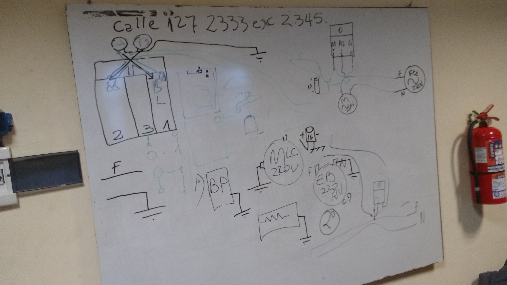

% Clase Nº 8: Lavarropas, presostato, solenoides y motores universales
% Andrés Imlauer
% 16 Julio 2024

#### Audio de la clase:

[https://youtu.be/HOFVsSnZ_a4](https://youtu.be/HOFVsSnZ_a4)

[https://voca.ro/1c9hVPuRPWbh](https://voca.ro/1c9hVPuRPWbh)

#### O escuchala en invidious:

[https://redirect.invidious.io/watch?v=HOFVsSnZ_a4](https://redirect.invidious.io/watch?v=HOFVsSnZ_a4)

### 🔹 Motores y electrobombas

* Todos los motores tienen **bobinado** igual. ⚡
* Para probar una **electrobomba**, se conecta a **220V**. 💧
* Puede que la bomba funcione pero **no tire agua** si el eje está cortado. 🔧
* **Motores universales**: funcionan en corriente **continua y alterna**. 🔄

***

### 🔹 Solenoides y relays

* **Solenoide de carga** = **relay**. 🟢
* Se usan relays cuando la **potencia es alta**, para motores de lavado, centrifugado y resistencias. 💪
* Otros dispositivos de control pueden usar **triac**, a veces disparado por **diac** o rectificadores de silicio. ⚡

***

### 🔹 Presostato y electrovalvula

* **Presostato** = solo un **switch de contacto**, no tiene campo magnético. 🛑
* Posibles fallas en carga de agua:

  1. Deficiencia del **presostato** 💧
  2. Deficiencia de la **electrovalvula** 🚰
* Siempre revisar la **manguera** y la presión dentro de ella. 🔍
* Filtro de agua en la parte de atrás de la lavadora: sacar con **pinza**. 🛠️

***

### 🔹 Componentes del motor

* **Jaula de ardilla**: bobinas en diagonales. 🏐
* **Trazo grueso**: hierro al silicio. 🟫
* **Trazo fino**: aluminio, que **no se magnetiza**. ⚪
* Para medir:

  * Corriente alterna → resistencia ⚡
  * Corriente continua → impedancia (resistiva, capacitiva, inductiva) 🧲

***

### 🔹 Carbones y mantenimiento

* Si no hay carbón del tamaño exacto, comprar el **más grande** y ajustar con lija. 🪵
* Tener siempre **carbones de repuesto**: medidas 12,5mm y 13,5mm. 📏
* Si el carbón es más chico en un motor grande, **chispea mucho** ⚡🔥

***

### 🔹 Reparaciones y herramientas

* **Plancha**: limpiar platino con **lija**. ✨
* **Soldador**: 60W mejor, pero 30W recomendado para pistas delicadas 🔩.
* Uso de **mallita** para desoldar más que chupador. 🧰

***

### 🔹 Diagnósticos finales

* Revisar **carbón** y bobina con **tester** antes de armar motor. ✅
* Blocapuertas defectuoso → puede ser **triac**. 🚪
* Electrovalvula y bomba → **2 triacs cada uno** ⚡

***

Si querés, puedo hacer una **versión tipo “chuleta” visual**, con emojis y colores para cada componente/fallo, lista para estudiar rápido antes de un práctico. Esto lo hace mucho más fácil de memorizar.

¿Querés que haga esa versión?
¡Perfecto! Te hago un resumen con los puntos más importantes de tu transcripción y agrego emojis para que quede más visual y fácil de estudiar:

***

### 🔹 Interpretación y actitud ante la electricidad

* Los hornos y otros equipos permiten modificaciones, pero **hay que saber interpretar lo que está hecho** 🔧.
* La **cantidad de cables da susto**, pero no hay que temer, sino tener **respeto** ⚡.
* La seguridad depende más del **conocimiento** que de la práctica mecánica. 👷‍♂️

***

### 🔹 Tipos de motores y componentes

* Tipos fundamentales de motores: **universales** y **timer mecánico** ⏱️.
* Todos los motores funcionan con **campo magnético**:

  * **Jaula de ardilla**: chapas diagonales, aluminio + hierro al silicio 🏐
  * **Aluminio** → conduce electricidad, **no se magnetiza** ⚪
  * **Hierro al silicio** → se magnetiza ✅
* **Aluminio y hierro al silicio conforman la jaula de ardilla**.

***

### 🔹 Electrónica de lavadoras

* **Procesador**: recibe órdenes y controla la lavadora 🖥️.

  * Trabaja con **5V**, necesita **TRIAC** para disparar los 220V ⚡.
* **Relays** = solenoides que manejan componentes de alta potencia 🟢.
* **Electrobomba**: expulsa el agua 💧.
* **Presostato**: solo un **switch por presión**; informa al procesador mediante **pulso o PTC** 🛑.
* **Blocapuertas**: el chip no hace nada si la puerta no cierra 🚪.

***

### 🔹 Secuencia de chequeo del chip

1. Testea si **puede cargar agua** 💧.
2. Verifica que la **puerta esté bloqueada** 🔒.
3. Chequea otros **componentes antes de iniciar** 🛠️.
4. La **bomba puede funcionar antes de cargar agua**, para garantizar drenaje inicial. 💦

***

### 🔹 Electricidad y conexiones

* Para motores y bobinas: se necesita **fase y neutro** correctamente ⚡.
* Cada motor tiene aislantes **anti magnéticos pero conductores eléctricos**.
* El trazo grueso = hierro al silicio, el trazo fino = aluminio (en diagonal) 🏗️.

***

Si querés, puedo hacer otra versión **tipo “mapa visual con emojis y colores”** donde se vea claramente la **jaula de ardilla, procesador, relays, bomba y presostato**, lista para estudiar en 1 minuto. Esto ayuda mucho para memorizar rápido.

¿Querés que haga esa versión?

¡Perfecto! Te hago un resumen con los puntos más importantes de tu transcripción y agrego emojis para que sea más visual y fácil de estudiar:

***

### 🔹 Condiciones del trabajo eléctrico

* Para que haya **trabajo eléctrico**, debe existir **resistencia** ⚡.
* Si no hay resistencia → **cortocircuito** ❌.
* La **resistencia** en un motor determina el **consumo de amperaje** y, multiplicado por el voltaje, nos da la **potencia consumida** 🔋.

***

### 🔹 Resistencia vs Impedancia

* **Resistencia (R)** → corriente continua (DC) ⚡
* **Impedancia (Z)** → corriente alterna (AC) 🔄
* La impedancia puede ser:

  * **Resistiva** 🟫
  * **Capacitiva** 🟦
  * **Inductiva** 🟪
* Para generar trabajo eléctrico debe haber **caída de tensión** ⬇️.

***

### 🔹 Probar una electrobomba

* Conectar a **220V** ⚡💧
* Para electrobombas de **12V AC**, usar un **transformador**:

  * Primario → 220V
  * Secundario → 12V AC 🔄
* **Nunca hay transformador para DC pura**, necesita **variación de voltaje** (AC).

***

### 🔹 Corriente alterna vs continua punzante

* **Corriente alterna**: pasa de 0 → máximo → 0 → negativo → 0… infinitamente 🔄
* **Corriente continua punzante**: siempre positivo y negativo, no varía ⚡
* **Fuente conmutada / switching**: convierte DC punzante para usar en transformadores 🔧
* **Fuente lineal**: misma frecuencia que la “línea” de la casa, 50 Hz, se puede conectar a cualquier enchufe 🏠

***

Si querés, puedo hacer una **versión tipo esquema visual**, mostrando **resistencia, impedancia, transformador AC/DC, y tipos de fuentes**, lista para estudiar en un vistazo. Esto ayuda a entender la diferencia entre AC, DC, lineal y switching.

¿Querés que haga ese esquema visual?

¡Listo! Te hago un **resumen con los puntos más importantes** de tu transcripción, con emojis para que sea más visual y fácil de estudiar:

***

### 🔹 Motocompresor y parámetros eléctricos

* **PH = 1 fase → monofásico** ⚡
* Frecuencia: **50 Hz** (si fuera 60 Hz, calienta más) 🔥
* Voltaje nominal: **220–240 V** ⚡
* **LRA (Locked Rotor Amper)**: corriente inicial para romper la inercia → 24 A 🔧
* **Consumo normal**: 7 A ⚡
* La corriente y el voltaje determinan la **potencia**:

  * P = V × I 🔋
  * Voltaje alto → menos amper para misma potencia 💡
  * Voltaje bajo → más amper para misma potencia ⚡

***

### 🔹 Carga de baterías y amperaje

* 1 A por hora → carga lenta de batería ⏳
* Mejor usar cargadores de 15–20 A/h ⚡
* **Importante**: no confundir **tensión (V)** con **intensidad (A)** ⚡💡

***

### 🔹 Electrobomba y lavadora

* Electrobomba diseñada para **220 V AC** 💧
* El **chip** controla:

  1. **Blocapuertas** 🚪
  2. **Electrobomba** 💧
  3. **Electroválvula** 🚰
* Lavadoras modernas: verifican **carga de agua** antes de activar bomba 💦
* Dispensers:

  * 1 → jabón líquido 🧴
  * 2 → jabón en polvo 🧼
  * 3 → lavandina 🧴

***

### 🔹 Conexiones eléctricas

* Electroválvula: **3 cables** → 1 común + 2 colores 🌈
* **Tierra**:

  * Diferente en chip y placa ⚡
  * No unir distintas tierras si no corresponden 🔌
* Neutro → común con tierra donde corresponda 🟢
* Presostato: **solo switch**, informa al chip apertura/cierre 💧

  * No tiene fase ni neutro ⚡
  * Funciona como termostato de agua o aire 🔄

***

### 🔹 Conceptos de voltaje y potencia

* 220 V → menos amper para misma potencia que 110 V 🔌
* Una lámpara de 12 V no se puede enchufar a 220 V ⚠️
* La potencia se mantiene → P = V × I, el voltaje no cambia la energía consumida por sí solo 💡

***

Si querés, puedo hacer una **versión visual tipo “diagrama de lavadora”** con el chip, blocapuertas, electrobomba, electroválvulas, dispensers, presostato y tierra/neutro, todo en un solo esquema con colores y emojis. Esto ayuda muchísimo a memorizar cómo funciona.

¿Querés que haga ese esquema?

¡Perfecto! Te hago un **resumen con los puntos más importantes** de tu explicación sobre cómo funciona el presostato en la lavadora, con emojis para que sea más visual y fácil de estudiar:

***

### 🔹 Funcionamiento del presostato

* El **presostato** controla la cantidad de agua en la tina/tacho 💧
* Funciona como un **switch**, abre o cierra según la presión en la manguera. ⚡
* La manguera conectada entre **tacho y presostato** debe estar **sin fugas de aire** 🟢
* Cuando el agua sube, ejerce presión → **el diafragma abre o cierra el switch** 🔄
* Problemas comunes:

  * Manguera mordida por rata 🐀
  * Manguera reseca o floja 💨
  * Cortar la manguera cambia la presión → la lavadora **cargará menos agua** ⚠️

***

### 🔹 Medición y diagnóstico

* **No se puede “medir” el presostato** como tal, solo funciona o no funciona. ✅❌
* Se mide **continuidad** con tester:

  * Normalmente cerrado → deja pasar corriente mientras la tina se llena 🔔
  * Abierto → indica que la tina está llena 🚱
* **Presostato vs termostato**:

  * Presostato → cambia con **presión** 💧
  * Termostato → cambia con **temperatura** 🌡️

***

### 🔹 Señales digitales e inversores

* Algunas señales son **inversoras** 🔁:

  * 0 → da 1
  * 1 → da 0
* Al medir con tester:

  * Señal normal → continuidad suena cuando debe cerrar 🔔
  * Señal inversa → continuidad se interpreta al revés ⚡
* El chip **necesita información del presostato** para saber si puede cargar agua o no 🖥️

***

### 🔹 Conceptos clave

* Nunca cortar la manguera ⚠️
* La presión depende del **largo de la manguera** → determina cuánta agua carga 🏗️
* El chip **no activa la bomba ni carga agua** hasta recibir señal correcta del presostato 💧🖥️

***

Si querés, puedo hacer un **diagrama visual del presostato y la manguera**, mostrando cómo la presión de agua abre el switch, cómo el chip recibe la señal y cómo se interpreta la señal inversa. Esto ayuda muchísimo a entenderlo en 1 vistazo.

¿Querés que haga ese diagrama?

¡Perfecto! Te hago un **resumen con los puntos más importantes** de esta explicación sobre el presostato, el chip y las electroválvulas en la lavadora, con emojis para hacerlo más visual:

***

### 🔹 Flujo de señales entre chip y presostato

* La **placa/chip** envía señal al presostato para cargar agua 💧
* El presostato puede ser **normalmente abierto (NO)** o **normalmente cerrado (NC)** 🔄

  * NC → corriente pasa mientras se llena el agua
  * NO → corriente pasa cuando está vacío ⚡
* Voltaje de señal: **0.75–1.5 V** ⚡
* El chip **lee la señal** del presostato:

  * Si recibe información → 1
  * Si no recibe → 0
* Señales inversoras: a veces un 0 → indica 1 para el chip 🔁

***

### 🔹 Qué ocurre cuando hay fallo

* Si a los **8 minutos** el chip no recibe señal de carga completa, **marca error** ⏱️❌
* La señora puede notar que **carga el agua, pero no lava** 🧴
* Responsable del corte por tiempo → **presostato** ⚠️
* El chip **ordena cortar agua**, pero si el presostato no responde → sigue llenando → error marcado ❌💧

***

### 🔹 Electrovalvulas

* Funcionan con **campo magnético (solenoide)** ⚡🧲
* Al quitar electricidad → resorte cierra el paso del agua ⬇️
* Problema típico: si la válvula actúa sin electricidad → indica fallo de control eléctrico o mecánico 🔧

***

### 🔹 Diagnóstico práctico

* Revisar si el tacho giró 🏺
* Revisar nivel de agua 💧
* Comparar con señales del chip y presostato 🖥️
* Si se corta por tiempo → presostato es el responsable ⚠️
* Si el chip no recibe señal de corte → marca error ❌

***

### 🔹 Tip adicional: reparación de planchas

* Para limpiar platinos: usar **tira fina de lija** y cerrar ambos platinos juntos ✨
* Doblar suavemente para que haga contacto sin romperlo 🛠️

***

Si querés, puedo hacer un **diagrama visual completo** del **flujo de señales chip → presostato → electroválvula → motor**, mostrando qué ocurre cuando hay error de carga o de corte. Esto deja todo mucho más claro y fácil de estudiar en 1 vistazo.

¿Querés que haga ese diagrama?

¡Perfecto! Te hago un **resumen estructurado y visual** con los puntos más importantes de tu explicación sobre errores en la carga de agua y el funcionamiento del motor en la lavadora:

***

### 🔹 Posibles errores en la carga de agua

1. **Deficiencia del presostato** 💧

   * No corta al llegar al nivel correcto → no reboza
   * Puede incluir problemas en la **manguera** si está floja, reseca o perforada
   * Resultado: carga normal o algo menor, pero **el motor no funciona correctamente** ⚠️

2. **Deficiencia de la electroválvula** 🚰

   * Reboza → agua en exceso
   * Si la válvula no corta bien, aunque el chip ordene cortar, sigue entrando agua
   * Puede generar ropa mojada tras centrifugado o exceso de agua

3. **Presión del agua insuficiente o lenta** ⏳

   * El presostato no recibe señal a tiempo → **corte por tiempo**
   * Resultado: lavadora corta antes de llenar suficiente agua → **lavado incompleto**

4. **Suciedad en filtro de entrada** 🧹

   * Reduce velocidad de entrada de agua
   * Si el émbolo del filtro no baja correctamente → sigue cargando agua
   * Consecuencia: exceso de agua, ropa mojada o centrifugado ineficiente

***

### 🔹 Secuencia de funcionamiento normal

1. Entrada de agua a través de manguera y **electroválvula** 💧
2. **Presostato** mide presión y envía señal al chip 📡
3. Chip ordena cortar ingreso de agua cuando está llena ✅
4. Motor comienza el **proceso de lavado** 🔄

   * Motor necesita **fase y neutro** ⚡
5. Electrovalvula y bomba dejan de funcionar para permitir lavado ⚠️

***

### 🔹 Diagnóstico práctico

* Si cliente dice: “Cargó agua pero no lavó”

  * Revisar **motor**: es la causa si no se mueve ⚠️
  * Revisar **electroválvula** y **presostato** para descartar errores de agua 💧
* La información del presostato es crítica para que el chip autorice el lavado 🖥️

***

Si querés, puedo hacer un **diagrama visual de flujo de lavado**, mostrando:
**entrada de agua → filtro → presostato → chip → electrovalvula → motor**, con errores y consecuencias indicadas. Esto hace que sea **mucho más fácil de memorizar y diagnosticar**.

¿Querés que haga ese diagrama?

¡Genial! Te hago un **resumen completo y visual** de esta clase sobre **motores de lavadora y sus diferencias** con énfasis en los errores de funcionamiento:

***

### 🔹 Electroválvulas y entrada de agua 🚰

* **1 ingreso de agua, 2 electroválvulas**

  * El chip decide cuál válvula abrir según el ciclo de lavado
* Si el motor **no lava**, el problema no es del agua, **viene del motor** ⚡

***

### 🔹 Tipos de motores en lavadoras

1. **Motor universal (con placa electrónica) 🔌**

   * Un **solo bobinado** en el estator y otro en el rotor
   * Recibe **pulsos del chip** para controlar giro y sentido
   * Puede girar en **cualquier dirección** (horario/antihorario)
   * No tiene **capacitor**, porque no hay bobinas en paralelo

2. **Motor mecánico (sin chip) ⚙️**

   * Dos bobinas:

     * **Trabajo (lavado)**
     * **Arranque (centrifugado)**
   * Necesita **capacitor** (14–16 µF) para regular desfasaje y mejorar factor de potencia
   * Solo puede girar en sentido definido por el sistema mecánico

***

### 🔹 Componentes del motor universal

* **Estator:** bobina fija
* **Rotor:** bobinado móvil conectado a **carbones**
* **Carbones:** transfieren corriente al rotor, creando el **campo magnético**
* Problema común: **desgaste de carbones** → motor no recibe corriente → no funciona ⚠️

  * Cliente ve: “cargó agua pero no lava”
* Solución: revisar carbones, bobina y conexiones antes de armar de nuevo

***

### 🔹 Diagnóstico práctico

* Sacar **motor y probarlo en la mesa** ⚡

  * Arranca a máxima velocidad (14–15 mil rpm)
  * Comprobar conexión de **fase y neutro**
* Medir bobina y verificar estado de carbones
* Revisar conexiones antes de instalar en la lavadora

***

### 🔹 Notas adicionales

* Motor universal no requiere capacitor
* Motor mecánico sí requiere capacitor → mejora arranque y factor de potencia
* El primer arranque del motor es crítico para acoplarse a la cuba de lavado 🏺

***

Si querés, puedo hacer un **diagrama visual comparativo** entre **motor universal y motor mecánico**, mostrando bobinas, carbones, capacitor, conexión con el chip y flujo de corriente. Esto deja **clarísimo dónde fallan y cómo se diagnostican**.

¿Querés que haga ese diagrama?

¡Perfecto! Te hago un **resumen completo y visual** de todo lo que acabás de transcribir sobre **pruebas de motor y bomba de agua en lavadoras**:

***

### 🔹 Prueba de motor universal ⚡

1. **Precaución al conectar**

   * Agarrar el **chicote del cable**, nunca adelante → evita saltos peligrosos ⚠️
   * Colocar en recipiente con agua dulce (ofrece resistencia al paso de corriente) 💧

2. **Formas de prueba**

   * Agua en recipiente pequeño → motor puede moverse sin saltar
   * Fuente de 12V, transformador, o batería de auto → velocidad más baja pero suficiente para comprobar funcionamiento

3. **Diagnóstico de carbones** 🪛

   * Problema común: **desgaste de carbones** → rotor no se electrifica → motor no gira
   * Diferencia de tamaño:

     * Si carbón de 12 en motor de 13 → chispeo, comportamiento incorrecto ⚡
     * Mejor comprar más grande y lijar hasta ajustar suavemente
   * La **cola de ratón**: tira de cobre que conecta el carbón al rotor
   * Resorte interno debe permitir deslizamiento → si está rígido → falla

***

### 🔹 Proceso después del lavado 🌀

1. **Desagote y centrifugado**

   * No puede centrifugar con agua → presostato informa 1 a la placa
   * La placa recibe 0 → autoriza motor para centrifugar
   * **Auto-balance:** motor gira lentamente a ambos lados antes de acelerar

2. **Funcionamiento de la bomba de agua** 🚰

   * Bombea durante lavado y centrifugado hasta cortar completamente
   * Puede fallar durante 2do enjuague → cambiar bomba si no desagua bien
   * Problemas comunes: desgaste de **eje** o falta de **orings** en rotor → agua pasa donde no debe

3. **Estructura de la bomba**

   * Rotor con imán y paletas
   * Oring evita que el agua entre al circuito del motor
   * Eje de acero → se desgasta con el tiempo, no la goma

***

### 🔹 Consejos prácticos 🛠️

* Tener **bomba de repuesto** en el taller
* Revisar **carbones y bobinado** antes de asumir falla de placa
* Cada prueba debe ser progresiva: verificar motor → carbones → conexión → bomba

***

Si querés, puedo hacer un **diagrama visual del motor + rotor + carbones + bomba**, mostrando **flujo de corriente, señales de presostato y chip**, para que se vea **todo el proceso de lavado, desagote y centrifugado** de manera clara y rápida de entender.

¿Querés que haga ese diagrama?

¡Excelente! Acá podemos resumir y ordenar toda la explicación sobre **TRIACs, relays y control de carga de motores en lavadoras y equipos electrónicos**:

***

### 🔹 Problema inicial

* Si al sacudir la lavadora empieza a caer agua → **bomba dañada** → cambiar bomba.
* Si la bomba falla, puede **dañar la placa** → los elementos más afectados: **TRIACs**.

***

### 🔹 TRIAC vs Relay ⚡

| Característica | Relay                                       | TRIAC                                     |
| -------------- | ------------------------------------------- | ----------------------------------------- |
| Función        | Interruptor electromecánico                 | Interruptor electrónico de AC             |
| Potencia       | Muy alta                                    | Alta, menor costo que relay               |
| Disparo        | 12V+                                        | 0.x V (muy bajo voltaje)                  |
| Vida útil      | Mecánica → desgaste                         | Electrónica → sin desgaste mecánico       |
| Usos           | Motor de lavado, centrifugado, resistencias | Motores pequeños, bombas, cargas medianas |

* Relays grandes → se usan en **motores de split**, compresores, resistencias de alta potencia.
* TRIACs → se usan en **lavadoras, bombas y motores AC**, pueden reemplazar relays en muchos casos.

***

### 🔹 Funcionamiento de un TRIAC

* Tiene **3 pines**: MT1, MT2 y Gate (compuerta).
* La corriente alterna **pasa entre MT1 y MT2** si se aplica señal de disparo a la Gate.
* Puede controlar **220V AC** sin que el procesador lo maneje directamente.

**Notas importantes:**

* Algunos TRIACs se disparan con **DIAC**, otros con **rectificadores o resistencias**.
* La señal de la placa → disparo del TRIAC → permite que la corriente AC llegue a la carga (motor/bomba).

***

### 🔹 Medición de un TRIAC

1. Poner tester en **continuidad**:

   * Punta 1 → MT1
   * Punta 2 → Gate
   * Debe dar un valor en ohmios.
2. Invertir punta → mismo valor esperado.
3. MT2 siempre aislado, si da continuidad → TRIAC dañado.

***

### 🔹 Control de motor con TRIAC

1. Motor de 220V AC → 2 cables: fase y neutro.
2. Placa electrónica **no maneja directamente 220V**, solo dispara TRIAC.
3. TRIAC deja pasar corriente hacia el motor → motor funciona.
4. Se puede usar un pulsador o la señal de la placa para controlar el motor sin riesgo de sobrecarga de la placa.

***

Si querés, puedo hacer un **diagrama visual mostrando la placa, TRIAC, presostato, electrobomba y motor**, para que veas **cómo fluye la señal desde el chip hasta el motor/bomba** y dónde actúan TRIAC y relays. Esto deja clarísimo todo el control de carga y lavado.

¿Querés que haga ese diagrama?

Perfecto, vamos a organizar todo lo que estás describiendo para que quede **claro el rol de los TRIACs y resistencias en la placa de una lavadora** y cómo se hace funcionar la bomba, electroválvula y blocapuertas:

***

### 🔹 Principio de funcionamiento

1. **Placa electrónica (chip)** → solo maneja **señales de bajo voltaje**.
2. **Elementos que requieren 220V AC** (bomba, electroválvula, blocapuertas, motor) → **no los puede manejar directamente el chip**.
3. Para esto se usan **TRIACs o relays**:

   * Cada carga tiene su TRIAC o relay dedicado.
   * TRIAC → permite pasar 220V AC a la carga cuando recibe señal de la placa.

***

### 🔹 TRIAC y resistencias

* Cada TRIAC suele estar **acompañado de 2 resistencias muy cercanas**.
* Estas resistencias cumplen funciones de:

  * **Despolarización** → permiten que el TRIAC se apague correctamente.
  * Ajuste de disparo → evitan que el TRIAC se active con señales incorrectas.
* Siempre que se reemplaza un TRIAC, **es recomendable cambiar las dos resistencias asociadas**.

***

### 🔹 Control de cargas

| Carga          | Tipo de TRIAC/Relay  | Observaciones                                                      |
| -------------- | -------------------- | ------------------------------------------------------------------ |
| Blocapuertas   | TRIAC                | Trabaja 220V, disparado por chip                                   |
| Electroválvula | 2 TRIACs             | Cada válvula tiene su TRIAC                                        |
| Electrobomba   | 1 TRIAC              | Control total por TRIAC, funciona a 220V                           |
| Motor          | Dependiendo del tipo | Motor universal puede controlarse con TRIAC o relay según la placa |

* Todo lo que el **microcontrolador necesita manejar a 220V** → requiere **su propio TRIAC o relay**.
* La fuente, información y potencia están separadas:

  1. **Fuente** → da alimentación a chip y componentes de baja tensión.
  2. **Información** → señales del presostato, botones, sensores.
  3. **Potencia** → TRIACs y relays para cargas de 220V AC.

***

### 🔹 Cómo probar TRIACs y funcionamiento

* No se puede disparar TRIAC directamente con 220V sin riesgo.
* Para probar: usar **fuente de bajo voltaje** o colocar carga controlada.
* TRIAC recibe señal de la placa → permite paso de 220V a carga.
* TRIAC defectuoso → carga no funciona → revisar TRIAC + resistencias cercanas.
* En bloque de potencia, hay que identificar si es TRIAC, transistor de juntura, MOSFET o regulador según datasheet.

***

### 🔹 Conclusión práctica

* Cada carga a 220V necesita **su TRIAC o relay dedicado**.
* TRIAC = permite control de potencia con señales bajas del chip.
* Siempre revisar **TRIAC + resistencias asociadas** si falla la carga.
* Separación de fuentes: **chip de control** vs **cargas de potencia**.

***

Si querés, puedo hacer un **diagrama completo de la placa de lavadora** mostrando: **chip → TRIAC → bomba → electroválvula → blocapuertas**, con las resistencias de disparo, para que visualices **cómo fluye la señal y la potencia**. Esto resume toda la clase de manera gráfica.

¿Querés que haga ese diagrama?

***

## Publicación original de Andrés Imlauer

**Título original:** [AUDIO][APUNTE] Taller reparacion electrodomesticos (Clase 8) - Lavarropas. Relay. Triac. Presostato. Solenoide. Jaula ardilla. Motores universales. Hay que saber preguntar al cliente. 01:55:00 (no calienta la plancha XD, que pavote quiere probar con ella). Orrin. Entra agua bomba de agua. Cuando se usa RELAY y cuando TRIAC. Mosfet. En el final hay una complicada explicación. TRIAC cumple la misma función que un RELAY.

**Publicado:** 23 de agosto de 2024

<!-- Publicación original importada desde el tag electrodomesticos -->

#### Audio de la clase:
https://youtu.be/HOFVsSnZ_a4

https://voca.ro/1c9hVPuRPWbh

#### O escuchala en invidious:
https://redirect.invidious.io/watch?v=HOFVsSnZ_a4

Se cortó una parte en donde hablaba de como probar una electrobomba: tiene bobinado todos los motores son iguales.

#### Solenoide de carga.
El relay es un solenoide. 

Presostato: sólo es un switch de contacto.
El presostato no tiene ningún campo magnético.

Primero el lavarropas testea todo.   
Jaula de ardilla: estan en diagonales.  
El trazo grueso es hierro al silicio y el trazo fino es aluminio.

El aluminio no se magnetiza.

En la corriente alterna tenemos resistencia.  
Pero en la corriente continua encontraremos impedancia.

La impedancia puede ser:
1. Reactancia o impedancia resistiva
2. Capacitiva
3. Inductiva

Para probar una electrobomba tenemos que conectarla a 220v.

Puede ser que la bomba esté andando pero no tira el agua porque se cortó el eje, entonces el motor funciona pero las hélices no dan vueltas.

En un switch voy a medir si cierra.

### Chiste en la hora 2:04:00

Reparación de plancha: Más que limpiar el platino no hay, con una lija, con una lija.
Junta carbón de abrir y cerrar.

#### Dos posibles errores que pueden tener en la carga de agua
1. Por deficiencia del presostato, dentro de la falla del presostato
2. Por deficiencia de la electrovalvula.
3. Vamos a incluir la manguera, porque si yo mido la electrovalvula y está bien mido el presostato y está bien quiere decir que hay presión dentro de la manguera.
4. 02:12:00 La parte de atrás de la lavadora tenemos una entrada de agua adentro hay un filtro hay que sacar ese circuito con una pinza.

Motores universales: trabajan en corriente continua y alterna.

Si no tenés el carbón comprá el más grande, si no entra con lija lo corregís.

#### Siempre es recomendable tener carbones en el taller
hay dos medidas: diferencia 1mm una es de 12,5mm y otra es de 13,5mm 

Si ponemos el de 12 en el de 13 corremos el riesgo que chispee mucho.

Se usa **relay** cuando la potencia es mucha, que hace trabajar el motor de lavado centrifugado y la resistencia. 

Lo otro va con **triac**

02:53:16
#### Entonces
Revisamos como está el carbón si el carbón está bien, volvemos a armar todo como estaba medimos la bobina con el tester, armo devuelta el motor y le hago la prueba conecto en forma eléctrica.

En la próxima clase nos demostrará como hacer se conecta el bobinado del estator y como se conecta la corriente que va al rotor a través de los carbones.

Hay veces que hay triac que son disparados por diac y otras veces con rectificadores controlados por silicio y otras veces directo con resistencia.

Soldador de 60 watts es mejor, pero muchos técnicos recomiendan 30 watts porque muy potente se puede romper la pista. Si apenas hay un vientito con 30 watts cuesta demasiado soldar, el profesor suelda con mallita(malla) más que con el chupador (son desoldadores).

Para finalizar:
1. si no anda el blocapuertas puede ser el triac
2. si no anda la electrovalvula hay 2 triacs que corresponde a la electrovalvula.
3. tenemos problemas con la bomba hay 2 triacs que trabajan con la bomba.

### Transcripción
A un horno eléctrico le podés poner lo que vos quieras, tenemos que saber interpretar lo que está hecho.

En la época en donde yo hacía electricidad, es más interpretación.

Lo que juega en nuestra contra es el primer susto que vemos la cantidad de cables, pero si nosotros lo tomamos con naturalidad, no hay que tenerle miedo sino respeto porque es peligroso.

Pero si miramos del lado del que mata, pero tenemos que hacerlo porque es nuestro trabajo, yo he trabajado en empresas grandes pero siempre fui un empleado.

Y tenía que aguantar porque tenía 5 hijos.

Perdí muchos clientes porque mis clientes son los que me llevan cosas a mi casa.

Hay técnicos que nosaben medir la bobina, esta es la parte más complicado y es donde menos seguridad tienen.

Los técnicos van a ver un split o una licuadura, si la vela no prende y le cambiaron la vela y no encende, **se le acabó**, porque no saben interpretar.

Los técnicos no saben ni lo que es un capacitor, saben que si lo cambian funciona.

Hay muchos tipos de motores, hay dos fundamentales: universales y timer mecánico.

Si hacés una vez el service del aire no hay mucha ciencia ahí.

El procesador es el que recibe todas las órdenes.

La bomba, los solenoide de carga trabajan con 220.

El procesador no, trabaja con 5 voltios y necesita un TRIAC para disparar los 220.

El relay es un solenoide.

La electrobomba sirve para expulsar el agua.

### Que me está faltanddo?
Presostato pero es sólo un switch un contacto por presión.

## A la placa le informa por pulso o por PTC.

El chip manda la órden al blocapuertas, porque si la puerta no cierra entonces él no hace más nada. 

Entonces por lo general el chip de la lavadora suele hacer un testeo primero de algunos componentes porque si los componentes no funcionan entonces nada funciona.

### Qué es lo primero que tiene que hacer una señora si quiere lavar ropa?

Cargar el agua, entonces el chip antes de cargar el agua testea algunas cosas a ver si tiene sntido ordenar a cargar el agua a ver si se encuentra con otro problema, porque el quiere estar seguro de que puede desagotar.

El chip no ordenará que comience a cargar agua, 

Chequeos que hace antes de iniciar: 
1.  testeará funcionalidad, si la puerta bloqueo bien continúa con el resto.

2. Bomba para sacar el agua: van a ver que todavía no cargó agua y sin embargo la bomba va a funcionar.

Porque si después no puede enjuagar no importa pero por lo menos me va a tirar el agua y me va a dejar casi seca, con olor a jabón pero bueno no hay problema.

Yo ya sé como son el resto de los motores, todos tienen el mismo principio: el campo magnético

### Jaula de ardilla
Son la posiciones del hierro al silicio para recibir ese campo magnético.

Tengo chapas diagonales.

Los que tienen el mismo color son de aluminio, y lo otro es hierro al silicio.

## Aluminio y hierro al silicio así se conforma la jaula de ardilla.

El aluminio es anti magnético, pero sí pasa la electricidad.

No se puede magntizar porque no es de un material **ferroso**

### Sólo los ferrosos pueden magnetizarse derivados del hierro, y el acero.

# El trazo grueso del medio sería hierro al silicio y el trazo fino es ALUMINIO (Jaula de ardilla).

Está en diagonal, si acá tengo el polo norte acá tengo el polo sur, de un lado **empuja del otro lado chupa**.

Sí por equivocación llegó un motor que calienta, a lo mejor cayó algunas gotas de **electrodos**, y eso anula la jaula de ardilla, cada uno de estos debe tener un aislante **anti magnético** NO anti-eléctrico.

Se debe magnetizar en diagonal, el aluminio **NO SE MAGNETIZA**.

Necesito uno para la fase y otro para el neutro, si agarro un pedazo de cable y le pongo para los dos terminales.

### Una de las condiciones de trabajo eléctrico es la **RESISTENCIA**

Si no hay trabajo eléctrico es **CORTOCIRCUITO**.

Si yo enchufo un motor encontrará una resistencia en el pasaje eléctrico y esa resistencia va a ocacionar el consumo de un amperage ese amperage por el voltaje ** voy a saber que pontencia consume el motor**

O sea que todos los consumos eléctricos funcionan porque tenemos una impedancia.

### Por qué primero dije resistencia y después impedancia?
Porque la resistencia podemos tomar como una resistencia a un circuito eléctrico en la corriente continua, pero en la corriente alterna tenemos **impedancia**.

### Impedancia = corriente alterna
### Resistencia = corriente continua.

**Para que se produja un trabajo eléctrico debe haber una caída de tensión porque sino explota.**

**Puede ser una impedancia capacitiva o inductiva**

Para probar la bomba tengo que conectarla a 220.

Vamos a suponer que tengo una electrobomba de 12 voltios alterna. 

### ¿Cómo lo pruebo?
Con un transformador. De 220 a 12 voltios y en el bobinado primario tengo 220 y en el secundario tendré 12 voltios. Siempre tendré alterna.

No hay tansformador que pueda trabajar en corriente continua.

Yo necesito que la corriente tenga variación de voltaje para hacer un **transformador**. Y eso está presente en la corriente alterna, porque yo paso de 0 a un punto máximo y del máximo al 0, así infinitamente.

Es una corriente con ciclos.

Pero **también le puedo cargar al transformador una corriente continua PUNZANTE**, de un lado siempre será positiva y el otro negativo no va a variar.

Pero la corriente continua punzante siempre tendré el positivo y el negativo.
##  **¿Cómo se llama esa fuente?**
Conmutada o Switching

### Que tipo de fuente es la de arriba en donde yo puedo agarrar una corriente continua punzante y ponerlo a un transformador.

La Switching o conmutada trabaja con una corriente **continua punzante**.

Lineal se llama así porque tiene el mismo ciclo que la "línea", **¿qué significa?** que yo a este transformador puedo conectarlo a cualquier enchufe de la casa.

Porque en todos lados tengo una corriente de línea, a 50 ciclos.

# Motocompresor
## PH = 1 fase = monofásico.
## 50 hertz.
Si dice 60 hertz al tener más ya calentaría porque al tener menos ciclos calientaría.
## 220 a 311 pero siempre nos da la corriente eficaz.
## 220 a 240 voltios el trabajo normal.

## El motor para entrar en torque el funcionamiento consumirá 24 amper.

LRA: cuando rompe la inercia, la potencia de inercia: necesita 24 amper para hacer eso.

Y el consumo 7.

Esto acá no implica nada para el calibre del caño, porque esto está dado en horas. 24 amper hora.

1 amper hora.

Igual que un cargado de batería, vamos a suponer que diga 1 amper o mil miliamper, y la batería del auto tiene 65 amper hora. 

## Yo con ese de 1 amper puedo cargar la batería?

Sí puedo, sólo que tengo que esperar 1 amper por hora.

Mejor vamos a poner un cargador de 15 20 amper por hora.

Si tengo 1 amper con 50 voltios como puedo tener 12 amper con 12 voltios. 

01:11:40

El voltaje es una cosa y el amper es otra.

El panel solar para continua vos sabés cuantas horas te va a durar para continua si por ejemplo llenás la batería de 65 amper hora, vos tenés un artefacto de 1 amper tenés 1 hora, pero si pasas a alterna más alla de lo que se pierde ahí cambiaría o es 1 amper por hora?

No, la potencia es tensión por intensidad no es lo mismo 12 voltios a 1 amper que 220 a 1 amper. 

Vamos a suponer que un país tenemos 110 voltios, nosotros acá tenemos 220, entonces decimos que vamos a suponer que este consume: 1 watt. 

Y algunos creen que con 210 voltios va a consumir medio watt, pero no porque el amperage que consume consume la mitad, porque la potencia es 1 sóla.

Si yo hago un motor para 220 volts es tanta pontencia.

Si yo hago el mismo motor allá para misma potencia pero consumirá el doble de amper, o sea que allá tanto el 220 como el 110 vas a paar la misma plata por el consumo.

En 220 va a pasar menos amper para llevar a la misma potencia, por eso le paso a watts directamente.

65 por 12 eso tendría que pasarle a 65/220.

La lamparita de un auto es de 45 watts, yo tengo una lámpara acá de 40 watts no se puede cambiar.

Porque yo al elevar el voltaje, voy a elevar el movimiento de los electrones, o sea que yo el de 12 voltios si le enchufo al de 220 va a volar.

Es importante acordarte tensión e intensidad.

La electrobomba está hecho para 220 voltios de corriente alterna, entonces el chip lo primero que hará será ordenar el control y ya el bloqueo del blocapuertas. Le dió positivo va a controlar la electrobomba y 3ero va a controlar la electroválvula.

Ahora nosotros vamos a encontrarnos con una lavadora que  primero carga agua corta y ahí va a verficar la electrobomba (lavadora samsung, los drean no).

Yo ya les expliqué como cargaba el agua, por qué en el dispenser teníamos 3, el 1 es jabón líquido, el 3 el enjuage y el 2 el jabón en polvo.

### Antes de arrancar el lavarropas, la placa controla.
1. Blocapuertas
2. Electrobomba
3. Electroválvula

Vamos a tener 2 electroválvulas y con eso vamos a trabajar en los 3 dispensers. 

Cuando trae para 3 lavados va lavandina, porque te carga para jabón y te carga para lavandina.

Generalmente llegan en 3 divisiones.

En la conexión de la electroválvula vamos a tener un punto en común.

Vamos a encontrar así la conexión, vamos a ver que la conexión que va a la electroválvula del drean del whilpool es así.

Van a ver 3 cables.
Porque 1 es el común, 2 colores.

En las lavadoras serán marrón y azul. Ustedes por 1 lado vamos a encontrar la tierra porque en toda la placa habrá una pista más gruesa que será del nuetro. 

Nosotros en los diagramas encontraremos esta figura como tierra, y otra tipo de figura que es tierra también pero es distinta.

La tierra del chip será distinta que la tierra la placa porque habrán todo un circuito, condensadores, habrán zener, diodos, otros tipos de resistencia, habrán varios tipos de diodos.

Entonces vamos a tener que trabajar con tierra distinta porque no es lo mismo una corriente alterna de 220 volts qque una corriente directa porque posiblemente acá haya una tierra.

Vamos a suponer que tengo un capacitor de un lado positivo negativo de 12 voltios, que acá sirve para ser de 16 porque tiene que ser el voltaje de capacidad mayor de lo que tiene que soportar.

No importa porque acá vamos a tomar la misma tierra, este sería la tierra en 0 de 220 voltios.

Si mirás en un datasheet vamos a encontrar cosas así, los dos son tierra pero no son iguales.

No podés unir las dos tierras.

Depdende de la tierra que sea.

En la placa vamos a encontrar **puentes de alambre** que pasan al circuito pero en el papel NO.

#### Por qué tengo acá dos cables?
Voy a tener la misma tierra para las dos válvulas, como también para la bomba, la misma tierra para resistencia, todo voy a tenerlo en un punto en común en donde voy a necesitar NEUTRO.

Neutro todo a tierra. 

Voy a sacar la electrobomba y puedo medir en la mesa porque está hecha para 220 voltios de corriente alterna.

***

El chip trabaja con 5 voltios y el manda 220 voltios, **no es tan así pero nos va contando como van a aparecer las órdenes del chip**, luego como llegan los 220 arreglate vos.

El presostato le informó al chip que ya está completo.

### El presostato no tiene fase ni neutro
Porque es solo un switch o se abre o se cierra, es como un **termostato**. 

Acá si habrán dos informaciones porque el chip va a mandar y tiene que recibir.

### El presostato es un switch semejante a la ducha, se conecta a través de la fuerza del agua.
Acá levanta el aire.

### ¿cómo funciona?
Acá dentro vamos a suponer que tenés el tacho, la tina.

Acá viene una goma un poquito más gruesa, y baja de acá al tacho. Ahí le sigue una manguera mucho más finita, esa manguera está entre el tacho y el presostato, ahí no hay fuga de aire. O sea que el agua que empieza a cargarse acá empieza a ejercer presión de aire hacia arriba, entonces cuando llega a una cantidad de agua de acuerdo al largo de la manguera, ejerce tanto kilos de presión entonces el **diafragma abre y cierra**.

Nunca corta y rebosa el agua porque perdió la presión la manguera, ocurre cuando una rata muerde la goma entonces ya no hay acumulación de presión.

**Nunca le cuentes al cliente como se mata la rata xD**.

Pasa también cuando la mangerita se reseca o por la mala calidad de la manguera, y algunas veces la mangerita queda floja habría que poner un precinto mi consejo es **NO CORTAR LA MANGERA**, pero yo corto.

Porque el largo de la manguera depende de la cantidad de agua que hay acá dentro, por eso no es recomendable cortar.

¿Por qué? Porque si yo corto acá y desengancho el termostato , la presión para que el termostato se abra necesita mucho menos entonces quiere decir que para un lavado perfecto el agua llegaba aca y ahora el agua llegará a cargar menos agua y el **presostato va a cortar**.

Si tenés un problema que a la cliente no le carga el agua, y vemos que la manguera está bien, ¿cómo lo solucionamos?

### Si la señora dice no me carga agua, está lavando muy seco, como se soluciona? Cambiar el presostato es carísimo.

La manguera está bien, el problema no está en la manguera. 

No hay forma de medir el presostato es lo mismo que el termostato, no se puede medir. Funciona o no funciona.

Yo agarro el presostato, coloco el tester y mido continuidad.

Lo que tengo que medir en un presostato es si cierra el switch. 

### El presostato y en el termostato sólo podés medir continuidad, y el termostato.

Uno cambia con presión otro con temperatura.

### Qué es el presostato? Es un switch.

Esa manguera está entre el tacho y el presostato, ahí no hay fuga de aire. O sea que el agua que empieza a cargarse acá empieza a ejercer presión hacia arriba, entonces el diafragma abre y cierra.

***

Hay señales en las señales digitales que el uno puede estar cuando está en 0, y me va a dar el 0 cuando estoy en 1. Eso se llama inversor, y hay algunos que cuando estoy en 0 me da 0 , y cuando estoy en 1 me da 1.

Cuando trabajamos con placa, no siempre el 1 es 1. 

Cuando trabajamos con inversores no siempre el 1 es 1, porque hay circuitos que son **inversores**, que necesitan una 1 señal en baja para dar una señal en alta. 

Tomo el presostato y coloco el tester, y lo pongo en la escala de continuidad, puedo medir en ohm también, pero en continuidad tengo el sonido.

### Vamos a suponer que está en señal inversa y me da abierto porque no suena la campana.

**Tiene que estar en 0 para que me de 1. El chip debe recibir un 0 para que me de un 1**. Lo normal sería que esté normalmente cerrado para que cargue el agua cuando el agua carga todo el abre y el chip sabe que ya está cargada el agua, puede ser al revés que cuando está vacío está abierto.

El chip lee a la inversa que no ha información para él de que está cargado, entonces voy a cargar porque el no necesita del presostado, el necesita la información del presostato.

#### La placa te está diciendo como yo estoy en 0, significa que no hay agua.
Porque si yo tomara desde el presostato el funcionamiento del motor si tiene que ser normalmente abierto.

### Cuando está normalmente cerrado la corriente pasa al motor

El voltaje de acá puede ser 1 vol, o sea la placa está diciendo yo te estoy mandando 1 vol pero no está informando nada, entonces la placa le dice a las valvulas carguen el agua, entonces cuando cargó el agua, cierra el chip y entonces la placa dice "aaah me informaste que tengo 1 vol", ahora acá que estaba en 1 y acá estaba en 0.

Acá teníamos un 1 y acá teníamos un 0, que significa eso, que la placa está mandando porque el informe salió de la placa, ingresó en el presostato pero no sale, recibe un 1 y da un 0.

Entonces la placa dice no tengo información de que la información que mandé la esté recibiendo en el otro pin.

Estoy puede valer 1.5 voltios 1 voltios.

Puede valer 1 voltio o 0.75 voltios

La información que le mandó al presostato, no recibe.

Puede pasar que el presostato no anda o no hay agua.

### Como el sabe que es tiempo de carga NO LEE COMO ERROR.

Si a los 8 minutos no recibe información de carga, el chip marca el error.

Si el presostato está así, pasó los 7 minutos de carga, el chip ordena que se corte el agua , el chip no sabe si cortó el agua, el sólo ordenó pero resulta que él sigue abierto, o sea no recibe la información que está bien de agua, entonces el CHIP **marca el error**

El chip no puede leer cual fue el error y a veces **marca un error de equivocado**

La señora nos dijo que se me inunda o no se inunda porque leyó rápido pero no me está lavando, y ese proceso justo cuando tine que entrar el motor, porque después que cargó agua, el chip me autoriza que el motor funcione.

Te traigo el lavarropas y te digo: me cara el agua pero no me lava.

Por qué la señora no me dijo REVOSÓ, porque el chip está bien, **el chip detectó que se excedió el tiempo**.

Hay que juntar la máxima cantidad de información posible.

### Me cargó bien el agua, me llenó de jabón pero no me lavó
Entró a funcionar el tacho porque no me lavó es muy general, porque a lo mejor giro dos veces el tacho y paró.

- Pero dió vueltas el tacho?
No, ni se movió

### Entonces le digo a perfecto y el agua hasta donde llegó ???
- Y llegó hasta donde siempre llega 

Esto quiere decir que cortó por tiempo.

### Y si cortó por tiempo quién es el responsable de que cortó por tiempo?
El presostato. 

Si ella no recibe después de los 7 minutos la información de que ya está en su carga de agua, y ordena cortar y acá corta. 

No va a seguir apareciendo más agua acá.

## El chip ordenó cortar el presostato porque ya llegó a los 8 minutos, pero no cortó entonces quiere decir que las **electroválvulas** obedecieron la orden pero el que **no responde es el presostato porque el CHIP sigue sabiendo que está en 0 por eso marcó el error**

Voy al otro caso, y el agua hasta donde llegó? 
- No rebozó todo.

Ah listo.

## La electroválvula me entró a funcionar sin electricidad

Esto quiere decir que el responsable **no** es el presostato.

Porque cuando el cargó el agua, el presostato cortó y le informó al chip que tiene un 1 . Que hizo el chip ordenó cortar el agua para que lave el motor, pero siguió cargando agua incluso hasta se empezó a mover el motor.

O sea que la electrovalvula me entró a funcionar uno de los problemas sin electricidad, porque cuando yo le sacó le mando electricidad a la electrovalvula forma un solenoide un campo magnético y abre la valvula para que el agua entre, pero cuando yo le saco la electricidad deja de tener el campo magnético el resorte vence y cierra el paso del agua.

### Yo le saqué la electricidad y el siguió llenando hasta que rebozó porque no hay formas de controlar, eléctricamente no se puede controlar más.

Un alumno arregló una plancha y la clienta dice que "no calienta".
 
Vamos a suponer que este es uno de los platinos y este es el otro, lo conveniente es agarrar una tirita finita no tirar y doblarle vamos a suponer que de este lado están los , entonces doblar así que tenga doble faz de grande.

### Y hacemos algo finito y metemos en el medio cerrarle la llave que cierre ambos platinos y limpiamos 2 a la vez.

Entonces ya vimos dos posibles errores que puede tener en la carga con agua:

1. Deficiencia en el presostato. (no reboza)
2. Deficiencia de la electroválvula. (reboza)

Dentro de la falla del presostato vamos a incluir la manguera, porque si yo mido la electroválvula y está bien, mido el presostato y está bien quiere decir **que hay problemas con la manguera**. Pero en ese caso el error no será parecido al primero que era el del presostato, sino que será igual al 2do, va a cargar demasiada agua, o va atener un nivel de corte y quen o lave.

Porque al no marcar la presión va a cargar y cargar si el ingreso del agua es normal un poquito para abajo va a cortar con tiempo.

Entones el agua va a quedar parecido a un llenado normal pero **no funcionará el motor**.

Pero si está rota la manguera y el agua es de mucha presión cuando el corte va a cortar bastante alto, porque el no tendrá el mensaje del pressotato que ya está lleno porque la manguera yay está pinchada. El agua estará bastante alta porque la presión es muy alta.

### Alumno: puede pasar que por la presión del agua no tenga mucha presión y la electroválvula tarde demasiado en cargar y salta ese error.

**Puede ser que el ingreso del agua es muy poca, entonces teniendo poquita agua, el va a cortar por tiempo.** 

Y en ese caso que sería el 4to, que tenemos que hacer?

Donde está el problema ahí?

## Dónde está el problema?

El termostato no se ensucia porque el agua nunca llega al presostato, después sólo aire para arriba.

Acá atrás de la lavadora la parte de atrás, tenemos una entrada de agua acá iría nuestra manguera para cargar el agua, entonces acá dentro cuando nosotros sacamos la tuerca plástica de la manguera de carga de agua adentro hay unos circuito como i fuera dedal invertido, es como un cosito que tiene una mallita plática, eso se suele ensuciar por la suciedad del agua, entonces la **velocidad de entrada del agua se ve reducida por la cantidad de basura**

En ese caso tenemos que sacar ese circuito hay que sacar ese circuito con una pinza trae una orejita plástica. 

Dentrás del filtro trae una orejita plastíca.

Entonces agarramos de ahí y estiramos, hay veces que cuando sacamos está rajado o está roto un agujero, si podemos cambiar mejor. Sino se cambia no va a influir en el lavado de la ropa.

Donde puede influir en el caso de que no tenga filtro la lavadora, vamos a suponer que nosotros miramos y ese filtro está muy roto, y nostorso nos hacemos los sotas y le ponemos igual

**donde podemos perjudicar a la lavadora??**

#### En la electroválvula

Porque esa mugre iría para adentro y se puede dar la causa de que se sobre llena de agua, y el presostato mandó la órden de que de que está llenado, el chip no mandó más corriente, sin embargo siguó cargando porque la suciedad no hizo que el émbolo de adentro baje bien para hacer de tabique, sino que siguió cargando agua.

En muchas veces se terminó de lavar todo pero al otro día, tiene mucha agua dentro de la ropa.

O a veces dicen que centrifugó bien pero está mojado, eso pasa porque **no cierra bien la electroválvula**.

La electroválvula anda bien, presostato anda bien, que significa eso?

Que cuando yo pongo en funcionamiento la lavadora debería marchar el morot,r porque cargó bien el agua el nivel el presostato marcó que ya tiene agua.

El chip ordena que corte el ingreso del agua, que le sigue cuando corta el agua??? El lavado

Para entrar al proceso de lavado necesita poner el motor en funcionamiento.

O sea que deja de funcionar la electrovalvula deja de funcionar la bomba y el presostato le informa con un 1 a la placa.

Entonces entra a lavar ya el proceso de lavado, empieza a lavar para un lado y para el otro.

El cliente nos puede decir que cargó bien el agua pero no lavo.

Y yo cada vez que desenchufo cierro el programa, pero no se mueve no lava. Quién es la causa?

Cuál es el elemento que no funcinoa para que no lave? **El motor**

No se mueve el motor 

El motor necesita fase y neutro.

***

Acá yo le estoy hablando a ustedes de 2 electroválvulas pero 1 sólo ingreso de agua.

Tiene 2 electroválvulas pero sólo 1 ingreso de agua.

Quiere decir que este único ingreso sirve para las dos electrovalvulas, todo depende de la orden del chip si funcionara la 1 o la 2.

Comenzó el motor que tendría que lavar pero no lava, entonces el problema viene del lado del motor. 

Muchos técnicos prueban si le llega voltaje desde la placa al motor, yo por lo general me acostumbré a sacar el motor y ponerlo en la mesa.

Porque si nosotros estamos hablando de que la lavadora tiene placa electrónica para el funcionamiento porque tiene el chip significa que el motor es de tipo UNIVERSAL.

Tiene 1 bobina que es manejada por pulsos desde el chip estos motores universales llevan así el nombre porque hay otras lavadoras que no tienen placa por lo tanto no tiene CHIP, es el sistema mecánico.

El sistema mecánico no tiene chip.

En esos tipos no se puede girar a orden antihorario.

Acá nosotros vamos a tener un selector entonces nosotros de acuerdo a donde elijamos el lavado que queremos esa información irá al chip y el chip se va a grabar y cumplirá esa función

Una vez que le dí el sentido, ya está ya el chip quedó grabado, lo único que leerá el chip será el apagado, no importa si es horario o antihorario.

El que tiene plac se puede dar vuelta para cualquier lado.

Si yo muevo el selector no hace nada, sigue con el problema de que le habías dado antes.

Porque el chip queda guardado.

En las otras lavadoras mecánicas si se puede cambiar el programa, pero no puedo volver para atrás.

El motor que tiene placa se llama motor universal.

El motor que no tiene placa trae una bobina para el trabajo de lavado, y otra bobina para el centrifugado.

### El motor universal no trae nunca capacitor porque tiene 1 sólo bobinado, no tiene bobina en paralelo

El que trae lavarropas mecánico siempre trae capacitor por lo general de 14 y 16 microfaradios, trabaja con 2 tipos de bobina uno de lavado y centrifugado.

### Como se llaman las bobinas en paralelo?
Trabajo y arranque.

Por la autoinducción que tiene y pro el desfasado que ocaciona debe tener un capacitor que regule eso para mejorar el factor de pontencia.

Por eso el motor de las lavadoras mecánico traen capacitor.

O sea que cuando yo saco el motor de la lavadora con placa electrónica el motor es de tipo universal.

## Los motores universales tiene un único trabajo bobinado en el estator y también tienen otro bobinado en el rotor pero no está en función de paralelo en el mismo campo.

### Entonces en un motor nosotros vamos a tener un bobina en el estator un bobinado de campo y vamos a tener un rotor que también tendrá bobina.

# El motor que no tiene bobina en el rotor se llama JAULA DE ARDILLA.

Este **no es un motor con jaula de ardilla**.

Este rotor de este lado tiene 1 conector con delgas. Que va comunicado a los alambres de que dentro del rotor.

Estas delgas están identificadas por unos carbones.

O sea que esos carbones son los que le dan la corriente al rotor.

Y también hay corriente que se le debe dar al estator.

Entonces uno de los problemas que hay cuando el lavarropas no lava, es que **no tiene más carbón** entonces no recibe más corriente el rotor para inmantar el campo magnético.

### Uno de los problemas que sufre es el desgaste del carbón.

Entonces si esto que está son los carbones necesita apoyarse para poder transferir la electricidad cuando se gasta no le alcanza más entonces no puede electrificarse y no funciona el motor.

Por lo general en este momento la lavadora no le largará el error de que está sin carbón.

## La clienta le dirá carga bien el agua pero no le lava, entonces casi seguro que el problema está en **los carbones**. 

A lo mejor ella tuvo un técnico anterior y le sacó le cambió el carbón.

Entonces yo reviso como está el carbón, si está bien vuelvo a armar todo como estaba.

Mido la bobina.

Armo de nuevo el motor y le hago la prueba.

Conecto en forma eléctrica.

La próxima clase veremos como conectar el bobinado del estator y la corriente que va al rotor a través de los carbones.

El motor en estos momentos arranca a la máxima.

Es un motor que anda a 14 mil vueltas andará a esa capacidad.

En los lavarropas que son para 9 y 12 kilos, quiere saltar de la mesa tiene que agarrar uno de los orneros en donde va acoplado a la cuba.

El primer arranque es el que le hace saltar, después ya no.

## Si carga bien el agua pero no lava, el problema son los carbones

Saco el rotor y pongo arriba de la mesa, pero si el problema está en la conexión en el cable seguiré buscando pero yo ya me voy a asesorar de como está conectado los carbones.

Entonces yo reviso como está el carbón si está bien, vuelvo a armar todo como estaba, armo de vuelta el motor y le hago la prueba.

Lo conecto en forma eléctrica. 

### La próxima clase daremos como se conecta el bobinado del estator y como se conecta la corriente que va al rotor a través de los carbones.

El motor si se prueba en la mesa arranca a la máxima, si es un motor que anda a 14 mil o 15 mil vueltas. 

### Algunos informes que hay se pueden hacer en una palangana en algo con agua, entonces antes de conectar vamos a suponer que yo agarro dos llaves de esas que se usan de boca y de anillo, le ato un cable bien fuerte y lo coloco.

### Tengo fase y neutro en las dos llaves, entonces yo agarro el recipiente con agua, y coloco a los extremos en el agua ya enchufado.

Agarro el chicote del cable porque si agarro adelante quedo pegado.

Estos dos son de metales y esta punta va puesta allá y hay 220 voltios, 

Coloco en el agua, como es agua dulce tiene poco mineral entonces ofrece resistencia al paso de la corriente, si coloco acá posiblemente el motor comienza a moverse porque es un recipiente chico  pero si es un recipiente grande cuando vos ponés dentro del agua no se mueve el motor.

Entonces agarro uno de estos y empiezo a arrimarlo a la otra llave.

### Que se logra con eso?

Que el motor no salte.

El primer golpe es el que asusta.

En los de más potencia salta mucho.

Otras de las maneras de probar, es con una fuente de 12 voltios.

Puede ser con un transformador que de 12 voltios a la salida.

O puede ser con una fuente que acá largue corriente alterna, porque son universales puede trabajar con cualquiera de las dos energías

O puedo colocar la batería del auto.

Anda con menos velocidad, una vez que ande se mueva y ande me daré cuenta que el problema **no es el bobinado del carbón ni tampoco en los carbones**

A veces se suelen quemar algunas de las pistas en donde entraba la ficha.

Esa es una de las formas de probar el motor de esa lavadora.

Armamos de nuevo quedó todo bien, cuál fue el problema?

En el caso que sea el carbón que no está llegando, **cambio el carbón**, diferencia 1 milímetro.

Si nosotros colocamos el de 12 en el de 13, corremos el riesgo que chispee mucho.

Porque tiene algún tipo de movimiento que hace que el comportamiento del carbón no sea la correcta y ocasiona picos elevados.

Mi consejo es sacar el carbón, no hace falta que digas dame el de 13 o el de 122.

### Si dudas comprá el más grande, porque lo podés lijar.

No nos pasemos porque hará que quede flojo.

Hay que probar cada vez que lijamos un poquito.

Si entró bien en la carbonera (suave entra y sale).

## Si quieren tener stock es recomendable tener las dos de 12,5.

El carbón es una barrita que acá dentro ya viene una tirita de cable de cobre a eso se lo llama cola de ratón que es un sistema de calcio y que no tiene forma.

Si nosotros no soldamos bien empieza a aparecer el estaño y le quita flexibilidad porque tiene que entrar dentro de una carbonera.

Y acá va un resorte, entonces ese resorte se achica bastante, y si el estaño entró acá queda casi fijo, y cuando el carbón se va gastando y quiere desgastarse se pega al costado del resorte y no se desliza.

# Es como que le falta carbón y el carbón todavía está nuevito

Terminó de lavar ahora que sigue?

El desagote. 

No puede centrifugar con agua adentro, el presostato le informará a la placa que sigue en 1.

Para que pueda entrar a centrifugar la placa debe recibir un 0.

Cuando recibe un 0, la placa ordena que el motor empiece a trabajar.

Las mayorías de las lavadoras modernas ahora tiene un proceso antes del centrifugado que se llama **AUTO-BALANCE**, da vueltas en menos velocidad, para un rato y da vuelta para ambos lados y luego empieza a acelerar para centrifugar.

Pero la bomba de agua sigue en funcionamiento hasta que corte el centrifugado.

La bomba trabaja una barbaridad, o sea que empieza a trabajar cuando el imán paró el motor porque tenía agua, recibió el 0 sacó toda el agua empezó a funcionar el motor para centrifugar y sigue **andando la bomba**, hasta que el motor no corta ella no corta.

### Por eso hay muchas fallas de bombas de agua.

Es conveniente tener en el taller una bomba de stock.

Podemos tener una bomba de agua perfectamente.

Lo que cambia es el modelo de las toberas.

**La bomba de agua no puede tener problemas porque ya antes de entrar en funcionamiento la lavadora ya testeó ella que andaba.**

Puede tener problemas en el desagote 

### Puede tener problema en el desagote después de que ella haya testeado?

¡Sí!. Cuando hizo el testeo le dió que andaba todo bien, pero cuando va a tirar el agua para hacer el centrifugado anduvo bien, pero cuando va a tirar el agua te tira error.

#### Ahí hay que cambiar la bomba.

# En muchas lavadoras pasa esto.

Cuando hace el 2do enjuague no tira el agua.

### ¿Que paso ahi?

Las bombas de agua son todas las mismas aunque cambien las marcas. Algunas tienen una válvula que otros no.

Acá me falta la parte de adelante en donde falta las elises, 

#### acá hay un tubo con una tapita con un orrin en el eje. Hay veces que entre el orrin que va acá que cierra para que el agua no pase para dentro.

Porque acá dentro de este rotor, hay un imán.

Entonces cuando la lavadora empieza a lavar, acá dentro no hay agua entonces funciona la placa. El chip cuando testea anda bien.

En el primer lavado entra muy poquita agua entonces tiró, pero sigue entrando agua de poquito porque tiene agua el tacho, cuando acá se llena de agua  en el espacio en donde tiene que crearse el campo magnético el agua hace un quilombo con el campo magnético porque no deja el espacio

### Entonces la bomba se atora y no funciona
Porque pasó agua dentro.

Acá dentro va un imán que con la bobina esto gira.

Entonces ahí gira y da vuelta las paletitas acá en el agujerito que se hizo tiene que estar un **orrin** para que el agua no PASE.

Aunque ustedes no crean el eje es de acero, y el que se gasta es el **eje** y no el circuito de goma.

Y ahí pasa el agua entonces.

Cuando aparece ese problema que no quiere andar si nosotros sacamos y agarramos donde van las paletitas se mueve, y eso **no se tiene que mover**

### Si empezamos a sacudir empieza a caer agua 

## HAY QUE CAMBIAR LA BOMBA.

### Ese problema también puede llegar a cambiar la placa

Que parte de la placa cambiará? LOS TRIACs

Acá está faltando un montón de cosas, porque no es tan así.

## Ahí aparecen los TRIACS y los relays, se usa relay cuando la potencia es mucha que hará trabajar el motor de lavado centrifugado y la resistencia.

Todo lo otro va con TRIAC. 

## En las placas de split cuando vamos a reparar vamos a encontrar un relay grandote ese relay es para el motorcompresor del split

Lo demás relays puede ser para la turbina de adentro, como el moto forzador que está afuera en el condenzador y puede ser para la válvula inversora (frío o calor).

DRY: De acá se omite usar un TRIAC o un relay aunque hay DRY de muy alta potencia como el caso de los inversores.

Lo que está acá pueden ser varias cosas todo depende de como está codificado, 3 pines, si fuera un transistor de juntura puede ser base, colector emisor.

Como puede ser emisor, base colector, porque NO todos los transistores son iguales.

Si fuera un mosfet puede ser compuerta, surtidor y drenador.

Es un transistor pero de otra forma.

También podemos encontrar un regulador de voltaje.

Acá viene 12 y a partir de la salida de este tengo los 8 para ese. Porque tendré una entrada una puesta a tierra y una salida ya regulada en 8 voltios.

En esa misma medida existen TRIACs y como también existe el TRIACS en ese formato y en esa medida, con 3 patitas que va en el sistema superficial y también son TRIACS.

NO SON TODOS IGUALES.

No podemos decir si es un mosfet, un regulador de voltaje, un transistor de juntura, tenemos que **mirar la definición**.

Hay veces que hay TRIAC que son disparados con DIAC y otras veces con rectificadores controlados con silicio y otras veces con resistencia y directo.

Cuando ustedes habían leído TRIAC, y que les quedó la duda.

Yo les explicaré la duda que les quedó.

### Tenemos una representación de un TRIAC que tiene 3 pines.

Acá también puede tener diferente ubicación sus pines.

Vamos a suponer que este sea la compuerta, el T1, el T2, como hay algunos lugares en donde nos aparece como RT1 RT2.

### Esto es un TRIAC. ¿Que quiere decir?
Si yo quiero disparar esta electrobomba, acá va a decir fase y neutro entonces yo voy a tomar la fase.

Cuando voltios le ingresa al TRIAC? 220 voltios, que **NO PUEDE HACER EL PROCESADOR**

El TRIAC puede soportar los 220. Es un transistor que se puede usar en **corriente alterna**.

Porque el primero que apareció se llamaba DIAC.

Esto está representado por DIODOS, la particularidad es el ánodo y cátodo. 

Son diodos rectificadores. Puentes rectificadores de onda completa, también existen rectificadores de media onda, o unos transformadores que vienen en 3 salidas. Tengo 6 arriba y 6 abajo tomando del punto medio pero si yo tomo los extremos tengo los 12 voltios.

### Entonces yo pongo 1 diodo en la salida de arriba y 1 diodo en la salida de abajo y mando a tierra el zener y ahi rectifiqué la corriente (para eso tenés que tener el transistor).

Entonces este TRIAC. 

El DIAC sólo pasa para 1 sólo lado la corriente, un regulador de corriente continua.

Pero en TRIAC va para dos lados la corriente, teníamos que usar un RELAY y el RELAY es mucho más caro que un TRIAC.

Cumple la misma función que un RELAY donde había RELAY ahora se pone un TRIAC, porque hay TRIAC De muy altos valores.

Que otros beneficios también tiene? Que el disparo se hace a muy bajo voltaje.

El relay se encuentra se encuentra desde 12 voltios para arriba. En cambio el TRIAC puedo disparar con 0.algo voltios.

En el 1er pin le dí entrada a los 220, el pin 2 es el terminal 2 suelen poner A, (ánodo 1 ánodo 2)

## El TRIAC si le puede dar los 220 a la bomba, el integrado va a disparar a la compuerta del TRIAC. El deja pasar la corriente del MT1 al MT2 y ahí trabaja.
# Como sabemos si el TRIAC anda o no?

Se mide a través de la continuidad en la compuerta. 

Una punta del tester en la terminal 1 y el otro en la compuerta, y ahí sí me tiene que dar un valor en ohmios.

Ahora yo retiro y doy vuelta, me tiene que dar el mismo valor en ohmios.

### Si yo cambio alguna de estas puntas no debe marcar NADA, si marca está mal. El 2 siempre está aislado.

#### Y como habilita el paso?

No me vas a saber dar respuesta, o

Vamos a suponer que tengo un motor de 220 voltios como un ventilador, acá voy a tener 2 cables.

El motor debe recibir 220 voltios.

Ahora yo quiero controlar con un pulsador el motor que está allá.

### Como hacemos?

Con un TRIAC.

No puedo disparar con 220 rompo el TRIAC.

El negativo de la pila debe ir conectado a alguno de los contactos.

Que faltaría para que el motor funcione?

Cuando trabajemos en placa, no funciona la bomba yo pongo arriba de la mesa me funciona bien.

Hay un triac adelante de los relay.

Quién más está trabajando con TRIAC?

Todo lo que está ahí trabaja con 220 y el chip no puede darle a cada uno. Cada uno tiene que tener un TRIAC independiente o un RELAY, 

### Y donde yo les dije en donde iba el relay?

Generalmente en estos TRIACS siempre está acompañadas de 2 resistencias, al rededor de ellas.

Porque hay que despolarizar para que termine.

Siempre hay que encontrar esas dos resistencia.

### Cambiamos el TRIAC y cambiamos la RESISTENCIA

Lo aconsejable es cambiar las dos resistencias.

03:20:39

#### Hay dos resistencias muy cerquitas y esas dos también deben cambiar.

#### Si dicen que no anda el blocapuertas puede ser el TRIAC.

#### Si tenemos un problema con la electrovalvula hay 2 triacs que corresponden a la electroválvula.

#### Tenemos un problema con la electrobomba hay un TRIAC que trabaja con la bomba.

## HAY UN TRIAC PARA CADA UNO.

Porque todo lo que es controlado por el micro y que trabaja a 220 necesita alguien que trabaje a 220.

03:24

Podés guardar todo en "componentes con duda" si no te da cortado.

Hay transistores de juntura, incluso hay unos circuitos que hacen funcionar este acoplador que se llama cero regulable. Después hay un cuadradito 3 patitas y una más grande, pero no podés decir a la vista si es un TRIAC, tenés que mirar un datasheet con las letras que dice el componente.

Es la parte de potencia porque el controlador no puede trabajar con la potencia entonces usa esos componentes para así poder trabajar a potencia a pleno.

Que trabaje a pleno la blocapuertas, la electrovalvula, la electrobomba.

Primero yo le hablé de la fuente, de esa parte salteamos a la parte de la información, de ahí salimos, llegamos a la parte de la potencia, la orden viene de la parte del proceso, hasta cuando nos animamos, podemos entrar a mirar de donde ese TRIAC recibe la información y seguir el circuito. 

Y ahí está la mayoría de los problemas.

En la corriente eléctrica se necesita trigonometría.

Conclusión final: "El trabajo dignifica, las bolas que dignifica eso te dice tu patrón, pagá bien gato"
